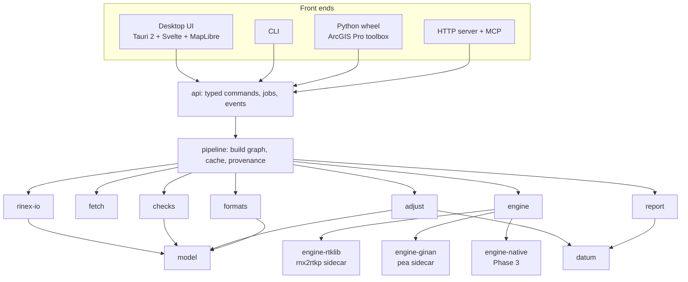

# Architecture

This is the technical design. The reasons behind the major choices are in [DECISIONS.md](DECISIONS.md), and the work breakdown is in [ROADMAP.md](ROADMAP.md). It's a living document: update it in the same PR as any change that departs from it.

## 1. Overview

All the logic lives in a Rust core. Each front end is a thin client of one typed command API, and baseline engines are swappable components behind a single interface.



## 2. Repository layout

```
crates/
  model/          domain types: marks, occupations, antennas, heights, sessions, baselines
  datum/          frames, epochs, transformations, plate motion, geoid, projections
  adjust/         least squares, testing, reliability, VCE, uncertainty, loop closures
  formats/        import/export: DynaML, STAR*NET, RTKLIB .pos, SINEX, LandXML, CSV, GeoPackage
  rinex-io/       RINEX ingest, header reconciliation, QC metrics
  fetch/          CORS data, orbits/clocks, ANTEX, site logs; cache; offline data packs
  engine/         BaselineEngine trait and shared job/result types
  engine-rtklib/  RTKLIB-EX sidecar driver
  engine-ginan/   Ginan sidecar driver (Phase 2)
  checks/         blunder detection rules
  pipeline/       build graph, content-addressed cache, provenance, verify
  report/         standards evaluation and report generation
  api/            typed command API used by every front end
apps/
  cli/            command-line interface
  desktop/        Tauri 2 app: src-tauri/ (Rust) and ui/ (Svelte + TypeScript)
  py/             PyO3 bindings and ArcGIS Pro toolbox (Phase 2)
  server/         axum HTTP server and MCP server (Phase 2)
packs/
  au/             Australian jurisdiction pack: frames, transformations, grids, standards, data sources
data/
  antennas/       antenna geometry catalogue (ARP and measure-up points, slant conversion)
sidecars/
  rtklib-ex/      pinned source reference, build scripts, checksums
benchmarks/       dataset manifests and runners (see VALIDATION.md)
docs/
```

Once the project is named (D-014), package names take a common prefix (for example `<name>-adjust`). The directory names stay short.

## 3. Crates

| Crate | Responsibility | Key dependencies |
|---|---|---|
| `model` | Domain entities, IDs, serialisation, schema versions | serde, toml, schemars |
| `datum` | Frames, epochs, Helmert transformations, plate motion, grids, geoid, projections | hifitime, nalgebra |
| `adjust` | Least squares, statistics, reliability, VCE, uncertainty, loops | faer (sparse), nalgebra, statrs |
| `formats` | Parsers and writers for exchange formats | quick-xml, csv, rusqlite (GeoPackage) |
| `rinex-io` | RINEX parsing (wrapped), header extraction, QC | rinex (nav-solutions, MPL-2.0) |
| `fetch` | Source registry, download, cache, data packs | reqwest, object_store or rust-s3, sha2 |
| `engine` | Engine trait, job and result types | none of note |
| `engine-rtklib` | Config generation, process management, output parsing | tokio (process) |
| `engine-ginan` | YAML config, process management, output parsing | serde_yaml |
| `checks` | Rule framework and built-in checks | none of note |
| `pipeline` | DAG execution, hashing, cache, provenance | tokio, rayon, blake3 |
| `report` | SP1 evaluation, HTML/PDF reports | minijinja; PDF per D-012 |
| `api` | Request/response types, jobs, events | serde, specta |

Dependencies are pinned and reviewed. cargo-deny enforces the licence policy (D-005): no GPL, AGPL or LGPL code is linked into our binaries. Copyleft tools may only run as separate processes.

## 4. Conventions

These are detailed in `docs/CONVENTIONS.md` (milestone M0). The essentials:

- **Units.** SI internally: metres, seconds and radians. Degrees appear only at I/O boundaries.
- **Coordinates.** ECEF (X, Y, Z) is the working representation. Geodetic and projected coordinates are derived views.
- **Frames and epochs.** Every position carries a `FrameId` and an `Epoch`. Combining positions across frames or epochs requires an explicit transformation. This is enforced by types where practical and by runtime checks otherwise.
- **Heights.** Heights are typed (`Ellipsoidal`, `Ahd`, `Avws` and so on) and record the model used.
- **Time.** Observation times use hifitime epochs in GPST. Frame epochs are decimal years, computed by a single documented function.
- **Covariances.** Full matrices in m². Never store only standard deviations where correlations exist.
- **Errors.** `thiserror` in libraries and `anyhow` only in binaries. Code never panics on user data, and the parsers are fuzzed to prove it.
- **Logging.** Structured logging with `tracing`. Provenance is a separate, durable record, not a log.
- **Numerics.** f64 throughout. Numeric paths iterate in a deterministic order (`BTreeMap` or `IndexMap`, never `HashMap`). Tolerances are defined centrally.
- **Determinism.** The same platform and build produce bit-identical outputs. Across platforms, results agree within 1e-6 m (FMA and SIMD can differ).

## 5. Domain model

The model is built around occupations. A baseline is something derived from two overlapping occupations, not a primary input. This is what makes the blunder checks possible.

```rust
/// A physical survey mark.
pub struct Mark {
    pub id: MarkId,                    // e.g. "PM12345"
    pub name: Option<String>,
    pub kind: MarkKind,                // PermanentMark, Cors, Temporary, ...
    pub approx: Option<Geodetic>,      // rough position, used by identity checks
    pub known: Vec<KnownCoordinate>,   // control values: frame, epoch, covariance, source
}

/// One set-up of one receiver and antenna over one mark for one time span.
pub struct Occupation {
    pub id: OccupationId,
    pub mark: MarkId,
    pub receiver: Receiver,            // make, model, serial, firmware
    pub antenna: Antenna,              // IGS code, radome, serial, calibration source
    pub height: HeightMeasurement,     // method, measure-up point, value, evidence
    pub span: TimeSpan,
    pub rinex: Vec<RawFileRef>,        // immutable originals, referenced by hash
    pub field_log: Option<AssetRef>,
}

pub enum HeightMethod {
    Vertical { to: MeasurePoint },     // e.g. ARP
    Slant { to: MeasurePoint },        // converted using the antenna geometry catalogue
}

/// A processed vector between two occupations.
pub struct BaselineSolution {
    pub from: OccupationId,
    pub to: OccupationId,
    pub frame: FrameId,                // frame of the orbits used
    pub epoch: Epoch,                  // mid-point of the overlap
    pub dxyz: Vector3<f64>,            // ECEF, metres
    pub cov: Matrix3<f64>,             // m², as reported by the engine
    pub quality: BaselineQuality,      // fix status, ratio, % fixed, RMS, overlap
    pub engine: EngineId,              // name, version, binary hash
}

/// What the adjustment consumes.
pub enum Observation {
    GnssBaseline(BaselineRef),
    GnssBaselineCluster(Vec<BaselineRef>, ClusterCovariance),
    PointCluster(Vec<MarkId>, PositionsWithCovariance),
    // Phase 3: HeightDifference, Distance, Direction, ZenithAngle
}
```

Sessions are derived by grouping overlapping occupations. Candidate baselines are derived from sessions, and independent baselines are then selected from the candidates (section 9.3).

## 6. Project format

A project is a folder. It's text-diffable, works in Git, and can be zipped and handed to someone else.

```
my-survey/
  project.toml           # name, jurisdiction pack, target frame, standards spec, defaults
  marks.toml             # marks and known coordinates
  occupations/           # one TOML file per occupation
  raw/                   # original files, never modified
  raw.lock               # SHA-256 of every raw file
  fieldlogs/             # captured logs and photos
  overlays/              # recorded corrections (e.g. header fixes), each with a reason
  results/               # adjustments and reports (regenerable)
  provenance.jsonl       # append-only record of every run
  .cache/                # content-addressed derived data (git-ignored)
```

An occupation file looks like this:

```toml
schema = 1
id = "2026-10-14-PM12345-A"
mark = "PM12345"
start = "2026-10-14T00:12:00Z"
end = "2026-10-14T02:31:30Z"
rinex = ["raw/PM12345A.rnx"]

[receiver]
make = "Leica"
model = "GS10"
serial = "1234567"

[antenna]
igs = "LEIAS10"
radome = "NONE"
serial = "7654321"

[height]
method = "vertical"
to = "ARP"
value = 1.5320           # metres
measured_by = "CL"
photos = ["fieldlogs/2026-10-14-PM12345-A-tape.jpg"]
```

The rules:

- `raw/` is immutable. Every load verifies its hashes against `raw.lock`.
- Corrections, such as a wrong antenna height in a RINEX header, are overlays that record the reason. They're never edits to the raw files.
- Everything in `results/` and `.cache/` can be regenerated from the rest.
- Every file has a schema version, and migrations are automatic and logged.
- Each file has a JSON Schema (generated with schemars), so editors validate as you type.

## 7. Pipeline and provenance

Processing is a build graph, as in a build system:

```
ingest(raw) → normalise(occupation) → qc(occupation)
           → process(baseline, settings, engine) → vector set
           → adjust(config) → evaluate(standards) → report(template)
checks run as nodes alongside, wherever their inputs exist
```

- **Node keys** are `blake3(canonical inputs + upstream keys + settings + tool versions)`. Tool versions include the crate version, git hash and sidecar binary hash.
- **The cache** lives in `.cache/<key>/`, holding outputs plus metadata. Garbage collection is by reachability from the current graph.
- **Execution.** tokio orchestrates, rayon handles CPU-bound maths, and a process pool runs sidecars. Every job supports cancellation and emits progress events.
- **Incremental by construction.** Changing an antenna height invalidates that occupation's baselines and everything downstream of them, and nothing else.
- **Provenance.** Every run appends a JSONL record per node: computed or cached, inputs, settings, engine, outputs and duration. For example:

```json
{"run":"2026-10-15T03:12:44Z","app":"0.3.0+3f2a1c","node":"baseline/9c1e","status":"computed","inputs":["rinex/77ab","rinex/12cd","nav/aa01"],"settings":"set/41fe","engine":"rtklib-ex 2.5.0 blake3:5d0e","outputs":["sol/9c1e"],"ms":4210}
```

- **`verify`** re-runs the whole graph while ignoring the cache, then compares output hashes. This is the audit answer to "how did you get this number?"

## 8. Command API and front ends

- The `api` crate defines a typed request/response pair for every operation, for example `ImportRinex`, `SetHeight`, `ProcessBaselines`, `Adjust`, `Explain`, `Export`.
- Long-running operations return a `JobId` and emit `JobProgress`, `JobFinished` and `IssueRaised` events.
- **Transports:**

  | Transport | Used by |
  |---|---|
  | Tauri IPC | Desktop app |
  | In-process calls | CLI |
  | PyO3 | Python |
  | HTTP/JSON (axum) | Server |
  | MCP tools | Agents |

- TypeScript types are generated from the Rust types with specta and tauri-specta, so the UI and core can't drift apart.
- **Rule: front ends contain no domain logic.** Anything a user can do in the UI can also be done through the CLI and Python, because they all call the same commands.

## 9. Baseline engines

### 9.1 Engine interface

```rust
pub trait BaselineEngine: Send + Sync {
    /// Name, version and binary hash, recorded in provenance.
    fn id(&self) -> EngineId;
    /// Supported modes, constellations, frequencies and recommended baseline lengths.
    fn capabilities(&self) -> Capabilities;
    /// Process one baseline. Must be deterministic for the same inputs.
    fn process(&self, job: &BaselineJob, cx: &JobContext) -> Result<BaselineOutcome, EngineError>;
}
```

A `BaselineJob` carries:
- the normalised rover and base RINEX
- navigation data and products
- ANTEX
- the base coordinate, in the orbit frame at the observation epoch
- the reconciled antenna information
- the processing settings

A `BaselineOutcome` carries the solution, the quality metrics, a residuals reference, the engine log and the list of attempts.

### 9.2 Why sidecars

Engines run as separate processes rather than linked libraries:

- **Re-entrancy.** RTKLIB's post-processing keeps state in file-level globals, so it can't run several baselines in parallel within one process. One process per baseline gives parallelism for free.
- **Crash isolation.** A malformed file can crash C code. Here, it kills one job, not the app.
- **Version pinning.** Each engine is a binary with a hash, recorded in provenance.
- **Licence hygiene.** The same mechanism lets us use copyleft tools without linking them (D-005).

### 9.3 RTKLIB-EX sidecar

- **Build.** `rnx2rtkp` is built in CI from a pinned RTKLIB-EX tag for each target, with checksums. Tauri bundles it with `externalBin`, and the CLI ships it alongside. At runtime the binary's hash is verified before use.
- **Config.** The driver generates one config file per baseline. The example below is illustrative; the option names are checked against RTKLIB-EX source, and the real values come from the project settings:

```ini
pos1-posmode      =static
pos1-soltype      =combined
pos1-frequency    =l1+l2
pos1-elmask       =15            # degrees
pos1-ionoopt      =brdc          # short baselines; longer ones use dual-freq or est-stec
pos1-tropopt      =saas          # longer baselines use est-ztd
pos1-navsys       =41            # bitmask: gps(1) + gal(8) + bds(32)
pos2-armode       =continuous
pos2-gloarmode    =off           # see D-019
pos2-arthres      =3
out-solformat     =xyz
out-solstatic     =single        # one final static solution
out-outstat       =residual      # residuals for the inspector
ant1-anttype      =*             # antenna type and deltas from the reconciled RINEX header
ant2-anttype      =*
ant2-postype      =xyz
ant2-pos1         =<X>           # base ECEF, in the orbit frame at the observation epoch
ant2-pos2         =<Y>
ant2-pos3         =<Z>
file-satantfile   =igs20.atx
file-rcvantfile   =igs20.atx
```

- **Header correctness matters.** Because `*` takes the antenna type and deltas from the RINEX header, the driver always feeds RTKLIB the *reconciled* RINEX (originals plus overlays), never the raw file.
- **Frames.** RTKLIB has no concept of frames. Transforming the base coordinate into the orbit frame and epoch is our job (section 11.2).

When parsing the output, watch for these:

- **Covariance signs.** In `.pos` output, the off-diagonal covariance columns (`sdxy`, `sdyz`, `sdzx`) are written as `sign(c)·sqrt(|c|)`. Recover the covariance as `c = sign(v)·v²`. RTKLIB's own solution reader squares these values and loses the sign, so don't copy that code.
- **Q flag.** 1 is fix, 2 float, 3 SBAS, 4 DGPS, 5 single, 6 PPP. Only Q=1 with a passing ratio counts as fixed.
- **Forward/backward agreement.** RTKLIB-EX only validates forward fixes against backward fixes in kinematic and moving-base modes, not static. The driver therefore also runs forward-only and backward-only solutions and compares them itself. Disagreement beyond their combined uncertainty marks the baseline as suspect.
- **`out-solstatic=single`** gives one final solution with covariance. Per-epoch output (`all`) is only produced for the inspector.

**Baseline selection.** Within each session, choose independent baselines (n − 1 for n receivers) using one of these strategies:
- a minimum spanning tree weighted by length and data quality
- radial from the nearest CORS
- a user-defined set

Trivial baselines are excluded from the adjustment by default but kept for loop checks. All selections are recorded.

**Retries.** When a baseline doesn't fix, a documented ladder of variations is tried: raise the elevation mask, exclude satellites with high residuals, trim the time window. Each attempt is a separate pipeline node with its own provenance. The user sees what was tried and why the final result was chosen.

### 9.4 Ginan (Phase 2)

- Runs Ginan's `pea` executable as a sidecar, with a generated YAML config.
- Used for single-site PPP (an offline equivalent of AUSPOS), long baselines through PPP-derived constraints, and products that need bias handling.
- Ginan is Apache-2.0, so linking would be allowed. We keep process isolation anyway for the reasons in section 9.2.

### 9.5 Native engine (Phase 3)

The native engine is a batch double-difference least squares solver for static sessions. It processes the whole session at once rather than filtering epoch by epoch, which suits static work better than RTKLIB's real-time-oriented Kalman filter. It also extends naturally to multi-baseline sessions with full correlations. Planned modules:

- observation modelling (PCO/PCV, troposphere, tides)
- cycle-slip detection
- float solution
- LAMBDA/MLAMBDA with partial ambiguity resolution and validation
- covariance realism

It only becomes the default once it matches or beats RTKLIB-EX on every benchmark gate.

## 10. Adjustment

### 10.1 Functional model

The unknowns are ECEF coordinates for each mark, plus nuisance parameters:
- set-up offsets per occupation
- later, optional per-group transformation parameters

A GNSS baseline from occupation *k* on mark *i* to occupation *l* on mark *j* is modelled as:

```math
\Delta X_{ij} = (X_j + \delta_l) - (X_i + \delta_k)
```

Here the vector has already been reduced to the marks using the antenna heights and calibrations. The δ terms are set-up errors (centring and height measurement), with zero-mean priors. A point cluster (control) observes `X_i` directly.

For GNSS-only networks the model is linear in ECEF, so no iteration is needed. Iteration arrives with VCE and, in Phase 3, with terrestrial observations.

### 10.2 Stochastic model

- `Σ_ll = σ₀² Q_ll`, with `Q_ll` built from the engine covariances and per-group scale factors `k_g` (from VCE or set by the user).
- Set-up priors are rotated from local ENU to ECEF:

  ```math
  \Sigma_{\delta_k} = R_k^T \operatorname{diag}(\sigma_h^2, \sigma_h^2, \sigma_v^2) R_k
  ```

  Because δ is a parameter shared by every vector from that occupation, the vectors are correctly correlated through their common set-up. Defaults are documented and configurable per equipment type.
- Baseline clusters keep their full covariance.

### 10.3 Datum definition

GNSS vectors carry scale and orientation from the orbits, so a vector-only network has a 3-parameter translation defect.

- **Minimally constrained.** Fix one mark, or apply inner constraints on translation. The residuals and test statistics are invariant to which choice is made, and this invariance is a property test.
- **Constrained.** Control marks enter as weighted constraints with their covariance (point clusters), or as hard constraints if the user asks. Comparing constrained and minimally constrained solutions tests the consistency of the control: `ΔΩ = Ω_c − Ω_mc` is tested against χ² with (constraints − 3) degrees of freedom, and inconsistent control is reported by mark.

### 10.4 Solution

- Normal equations `N = AᵀPA` and `u = AᵀPl`, solved by sparse Cholesky factorisation with AMD ordering (faer). The matrix has a natural 3×3 block structure.
- Parameter covariance `Q_x̂ = N⁻¹`:
  - **Up to about 2,000 marks:** compute the full inverse densely.
  - **Larger networks:** compute only the blocks that are needed, using a selected inverse (Takahashi equations). These are the mark diagonals, the pairs required for RU, and the blocks needed for `Q_v̂v̂`.
- Residuals `v̂ = A x̂ − l`, and `Q_v̂v̂ = Q_ll − A Q_x̂ Aᵀ`. Only the per-observation blocks are needed.
- The weighted sum of squares is `Ω = v̂ᵀPv̂`, with *r* degrees of freedom.

### 10.5 Statistical testing

- **Global test.** `Ω/σ₀² ~ χ²(r)`, two-tailed.
- **w-test (data snooping, σ₀ known).** For each alternative vector *c* (one per vector component, expressed in local ENU so results read as horizontal or vertical):

  ```math
  w = \frac{c^T P \hat v}{\sigma_0 \sqrt{c^T P Q_{\hat v \hat v} P c}} \sim N(0,1)
  ```

- **Vector test (3 DoF).** For vector *i*, with `C_i` selecting its three components:

  ```math
  T_i = \frac{\hat v^T P C_i \,(C_i^T P Q_{\hat v \hat v} P C_i)^{-1}\, C_i^T P \hat v}{\sigma_0^2} \sim \chi^2_3
  ```

- **Tau test (Pope)** is available when the a posteriori variance factor is used.
- **Critical values** follow Baarda's B-method. Choose α₀ (default 0.1%) and β₀ (default 80%), giving λ₀ ≈ 17.07. The levels for the 3-DoF test and the global test are derived from the same λ₀ and β₀, so all tests are equally sensitive.
- **Outlier handling.** Suspects are ranked by test statistic and shown with evidence. Excluding or re-weighting an observation is a recorded user action, and the tool never iterates silently.

### 10.6 Reliability

- **Redundancy numbers:** `r_i = (Q_v̂v̂ P)_ii`, which sum to *r*. They show how well each observation is checked by the others.
- **Minimal detectable bias:**

  ```math
  |\nabla_c| = \sigma_0 \sqrt{\frac{\lambda_0}{c^T P Q_{\hat v \hat v} P c}}
  ```

  For uncorrelated observations this reduces to `σ_i·sqrt(λ₀/r_i)`.
- **External reliability:** `∇x̂ = Q_x̂ AᵀP c ∇_c`, the largest coordinate shift that an undetectable blunder could cause.
- MDBs and external reliability are drawn on the map, so weak parts of the network are visible before anyone looks at a table.

### 10.7 Variance component estimation

Group scale factors are estimated with the simplified Helmert (Förstner) estimator and iterated to convergence:

```math
\hat k_g = \frac{\hat v_g^T P_g \hat v_g}{r_g}, \qquad r_g = \operatorname{tr}\big((Q_{\hat v \hat v} P)_{gg}\big)
```

Groups can be sessions, engines, receiver types or any other user-defined split. Each factor is reported with its redundancy. A warning is raised when a group has too little redundancy (r_g below about 10) for a meaningful estimate. The factors are the evidence for, or against, the realism of the engine covariances.

### 10.8 Uncertainty and SP1

- Mark covariances come from `Q_x̂`, scaled per project policy (a priori or a posteriori variance factor). The policy is recorded.
- **Error ellipses.** Rotate the covariance to local ENU. The horizontal 2×2 block gives the standard error ellipse. The 95% ellipse scales it by `sqrt(χ²₂(0.95)) ≈ 2.4477`, and the vertical 95% value is `1.96·σ_u`.
- **Positional uncertainty (PU), per SP1 v2.2 section 4.2.** The horizontal PU is the 95% circular measure derived from the error ellipse, computed exactly as the ICSM *Guideline for Adjustment and Evaluation of Survey Control* specifies. The vertical PU is `1.96·σ_u` (95%). PU is relative to the datum, so it includes control uncertainty, which comes naturally from weighted constraints.
- **Relative uncertainty (RU)** between marks *i* and *j* uses `Σ_Δ = Σ_ii + Σ_jj − Σ_ij − Σ_ji`, rotated to local ENU, with the same 95% measures. RU excludes datum uncertainty.
- **AHD uncertainty** combines the ellipsoidal height uncertainty with the AUSGeoid2020 uncertainty at the mark, per SP1 section 4.2.2. The combination rule is defined in the jurisdiction pack.
- Jurisdiction-specific measures, such as Local Uncertainty where it's still published (for example in SCIMS), are computed by pack-defined evaluators.
- Every formula is checked against the guideline text and ICSM worked examples before v1.0 (M12).

### 10.9 Loop closures and repeat baselines

- **Loops.** Build a graph with marks as nodes and selected vectors as edges. A spanning tree gives a fundamental cycle basis: each non-tree edge closes exactly one loop. The misclosure is `w = Σ s_k ΔX_k` with signs from direction, and `Σ_w` comes from the loop vectors including any cluster correlations. Test `wᵀΣ_w⁻¹w ~ χ²(3)`, and report the misclosure in ENU (mm) and as ppm of loop length.
- **Repeat baselines.** Differences between repeated vectors over the same mark pair, tested the same way.
- Loops are a pre-adjustment screen and an aid to explanation. They don't replace the adjustment tests.

## 11. Datums and geodesy

### 11.1 Frames, epochs and the transformation graph

- **A frame registry** with dynamic frames (ITRF2020, IGS20, ITRF2014, ATRF2014), which need an epoch, and static frames (GDA2020, GDA94), which have a fixed reference epoch.
- **A transformation graph.** Nodes are frames and edges are transformations. Each edge carries:
  - the method: Helmert 7, Helmert 14, plate motion, grid
  - its parameters and their source document
  - its validity area and time
  - its uncertainty
- **Explicit paths.** The tool finds a path, shows it, and records it in provenance. The datum panel in the app displays each step with its numbers.

### 11.2 Default strategy for Australia (D-017, to be validated with GA)

1. **Processing.** Engines work in the frame of the orbits (IGS20, consistent with ITRF2020) at the observation epoch. Base coordinates are transformed into that frame and epoch before processing.
2. **Adjustment.** This happens in ATRF2014 at a project reference epoch, by default the mean observation epoch.
   - Vectors are transformed from IGS20 using the ITRF2020 to ITRF2014 parameters. The effect on short vectors is sub-millimetre, but it's applied for rigour.
   - GDA2020 control is brought to the reference epoch with the Australian Plate Motion Model, carrying its uncertainty.
3. **Output.** Coordinates are transformed to GDA2020 with the plate motion model. Heights go to AHD via AUSGeoid2020, or to AVWS. Grid coordinates are in MGA2020.
4. **Shortcut.** For short local projects, adjusting directly in GDA2020 is acceptable. The tool computes the difference between the two routes and shows it, so the choice is based on evidence.

### 11.3 Heights

- Ellipsoidal heights (GRS80) are the working quantity.
- AHD heights are computed through AUSGeoid2020, with its uncertainty. AVWS heights are computed through the Australian gravimetric quasigeoid.
- Every height records its kind and the model used. There is no untyped "height".

### 11.4 Projections

- MGA2020 and MGA94 use Transverse Mercator via the Krüger n-series, which is accurate to well under a millimetre across a zone.
- Point scale factor, grid convergence, and line and combined scale factors (including height) for ground-distance work.

### 11.5 Implementation (D-011)

- **Native Rust** for the analytic pieces: ECEF and geodetic conversions, Helmert 7 and 14, plate motion and Transverse Mercator. They're small, fast and easy to test, and need no C dependency.
- **Grids:** a native NTv2 and GeoTIFF grid reader for the GDA94 to GDA2020 grids and the geoid models. This avoids building PROJ on every platform.
- **PROJ** serves as a test oracle, and optionally as a backend for jurisdictions whose transformations we haven't implemented natively.
- **Validation** is against GeodePy, PROJ and the GDA2020 Technical Manual examples (see [VALIDATION.md](VALIDATION.md)).

### 11.6 Jurisdiction packs

A pack is data, not code. It declares frames, transformations, grids, height models, standards and data sources. For example (illustrative):

```toml
[pack]
id = "au"
name = "Australia"
version = "0.1.0"

[frames]
target = "GDA2020"
adjustment = "ATRF2014"

[[transformations]]
from = "ITRF2014"
to = "GDA2020"
method = "plate-motion"
parameters = "transformations/itrf2014-gda2020.toml"
source = "GDA2020 Technical Manual"

[[grids]]
id = "ausgeoid2020"
kind = "geoid"
file = "AUSGeoid2020.gsb"
url = "<official download URL>"
sha256 = "<hash>"

[standards]
id = "icsm-sp1-v2.2"

[[data_sources]]
id = "ga-gnss-archive"
kind = "rinex"
api = "https://data.gnss.ga.gov.au/api/rinexFiles"
licence = "CC BY (confirm version with GA)"
```

Grid files are fetched and hash-verified rather than committed, unless their licence allows redistribution.

## 12. Blunder checks

```rust
pub trait Check: Send + Sync {
    fn id(&self) -> &'static str;                  // e.g. "antenna.height.header-mismatch"
    fn run(&self, project: &ProjectView) -> Vec<Issue>;
}

pub struct Issue {
    pub check: &'static str,
    pub severity: Severity,             // Info, Warning, Error
    pub objects: Vec<ObjectRef>,        // marks, occupations, baselines, observations
    pub message: String,                // plain-English summary
    pub evidence: Evidence,             // the numbers (and plots) that justify it
    pub fix: Option<SuggestedFix>,      // an action the user can apply, recorded as an overlay
    pub fingerprint: Fingerprint,       // stable ID so suppressions survive re-runs
}
```

- Checks run as pipeline nodes, so they're cached and re-run when their inputs change.
- Errors block the adjustment unless they're suppressed. A suppression records a reason, who made it and when, and appears in the report.

The initial catalogue (M9):

| ID | Detects |
|---|---|
| `antenna.height.header-mismatch` | Field log height differs from the RINEX header |
| `antenna.height.implausible` | Height outside the plausible range for the method and equipment |
| `antenna.height.inconsistent-repeat` | Same mark and equipment with different heights across sessions, beyond tolerance |
| `antenna.type.header-mismatch` | Field log antenna or radome differs from the RINEX header |
| `antenna.type.invalid-igs-code` | Antenna or radome code not valid in IGS naming |
| `antenna.calibration.missing` | Antenna not in the ANTEX in use, with the expected bias |
| `antenna.calibration.mixed-types` | Different uncalibrated antenna types at the two ends of a baseline |
| `mark.identity.split` | One mark ID with positions metres apart (a swap or typo) |
| `mark.identity.merge` | Different mark IDs within a few centimetres (probably the same mark) |
| `mark.identity.known-coordinate` | Approximate position inconsistent with the mark's known coordinates |
| `session.overlap.insufficient` | Overlap too short for the baseline length, per benchmark-derived guidance |
| `session.time.anomaly` | Clock jumps, time-system mismatch, duplicate or overlapping files |
| `network.redundancy.none` | Marks or vectors with no redundancy |
| `network.reliability.weak` | MDB above the project specification |
| `network.control.disconnected` | Control marks not connected to the network |

## 13. Data fetch

- **Planner.** Given the occupations, it works out what's needed: CORS RINEX for each window, navigation data, orbits and clocks of the right latency, ANTEX and site logs.
- **Sources** come from the jurisdiction pack. For Australia the GA GNSS Data Repository is available through its Web API, the S3 bucket `s3://ga-gnss-data-rinex-v1` and SFTP. Global products come from IGS mirrors that don't need a login.
- **Downloader.** Resumable, with checksums, retries with backoff, and proxy support through standard environment variables.
- **Cache.** A per-user cache shared across projects, keyed by content hash. Projects record exactly which files they used.
- **Offline data packs.** A zip containing the files plus a manifest of sources, hashes and licences. A pack is exported on a connected machine and imported on an air-gapped one.
- **Attribution.** Licence and attribution metadata follow the data into reports.

## 14. Desktop UI

- **Stack:**
  - Tauri 2.
  - Svelte 5, TypeScript and Vite.
  - MapLibre GL JS for maps and uPlot for time series.
  - Custom canvas sky plots.
  - TanStack Table, virtualised, for large tables.
  - Typed IPC via tauri-specta.
- **Layout.** Map-centric, with docked panels: Project, Issues, Inspector, Adjustment and Jobs.
- **Views:**

  | View | Shows |
  |---|---|
  | Map | Marks, baselines by quality, ellipses, loops, MDB |
  | Timeline | Occupation Gantt chart; overlaps reveal baselines |
  | Baseline inspector | Residuals, sky plot, SNR, slips, attempts |
  | Issues | Blunder checks with fixes and suppressions |
  | Adjustment | Global test, w-test ranking, VCE factors, PU/RU against spec |
  | Datum | Step-by-step transformation working |
  | Report | Preview |

- **Basemaps.** Providers are user-configurable, including ArcGIS basemap services with the user's own key. The app ships a small low-zoom world basemap as PMTiles, and supports offline PMTiles files. In offline mode, no tiles are fetched. Defaults respect provider usage policies (no bulk use of openstreetmap.org tiles).
- **State.** The UI holds view state only. Domain state lives in the core, is read through the API and is updated by events.
- **Accessibility.** Keyboard-first operation, screen reader labels, and light, dark and high-contrast outdoor themes.
- **Security.** Minimal Tauri capabilities: only the commands the UI needs, file system access scoped to the project and cache, and a strict CSP.

## 15. CLI

```
gnss init <dir> --pack au
gnss import rinex <files...>
gnss import fieldlog <files...>
gnss import vectors <file> --format dynaml|starnet|rtklib|csv
gnss import control <file> --format dynaml|csv|sinex
gnss fetch                      # CORS data, products and ANTEX for all occupations
gnss check                      # run blunder checks
gnss process                    # baselines
gnss adjust [--minimal|--constrained]
gnss report --format html|pdf
gnss export --format dynaml|starnet|landxml|gpkg|csv
gnss verify                     # re-run from scratch and compare output hashes
gnss bench run --manifest benchmarks/<manifest>.toml
```

- The binary name follows the project name (D-014).
- Every command supports `--json`.
- Exit codes:

  | Code | Meaning |
  |---|---|
  | 0 | Success |
  | 1 | Error |
  | 2 | A statistical test failed |
  | 3 | Blocking issues present |

## 16. Python and ArcGIS Pro (Phase 2)

- PyO3 bindings, built with maturin as abi3 wheels for Windows, macOS and Linux. They mirror the command API one to one.
- An ArcGIS Pro Python toolbox (`.pyt`) calls the Python API and uses arcpy to write:
  - marks as points
  - vectors as lines
  - error ellipses as polygons
  - a file geodatabase with domains and symbology
- Optional publishing to ArcGIS Online or Enterprise goes through the REST API (`applyEdits`). There's no dependency on the ArcGIS API for Python.

## 17. Server and MCP (Phase 2)

- **An axum server** exposes the command API over HTTP/JSON, with authentication and multiple projects, and can serve the same UI for agency deployments.
- **An MCP server** exposes read and analysis tools, for example:
  - list issues
  - explain an observation's test statistics
  - summarise QA
  - propose fixes

  Any write action requires explicit user approval and is recorded in provenance like any other change.

## 18. Packaging, distribution and updates

- **CLI:** cargo-dist, or a plain GitHub Actions matrix, builds archives and installers for each platform, with checksums.
- **Desktop:** the Tauri bundler produces MSI for Windows, a DMG for macOS (Developer ID signed and notarised), and AppImage and .deb for Linux, with Flatpak later.
- **Code signing:** Windows through SignPath (free for open-source projects) or a sponsored certificate; macOS through notarisation.
- **Updates:** opt-in, with signed update manifests. Air-gapped builds compile the updater out.
- **Supply chain:**
  - an SBOM (cargo-cyclonedx) per release
  - cargo-deny and cargo-audit in CI
  - sidecars built from pinned source in CI
  - reproducible builds as a goal

## 19. Security and privacy

- **Threats:**
  - untrusted input files (RINEX, vectors, field logs, products)
  - downloaded content
  - sidecar binaries
  - sensitive coordinates
- **Mitigations:**
  - memory-safe parsers with size limits, fuzzed in CI (cargo-fuzz)
  - sidecar hashes verified at runtime
  - network access only to hosts declared in packs or by the user
  - a true offline mode
- **Privacy:**
  - no telemetry
  - projects stay local
  - nothing is uploaded anywhere unless the user explicitly configures a destination
- **Process:** SECURITY.md with private vulnerability reporting, and a threat model doc maintained from M13.

## 20. Performance targets

These are for an 8-core laptop.

| Operation | Target |
|---|---|
| Adjust 1,000 marks and 3,000 vectors, including statistics | under 2 s |
| Adjust 10,000 marks with selected inverse | under 60 s |
| Process 50 baselines (2 h at 30 s) with RTKLIB-EX | under 1 min |
| Ingest and QC a 24 h, 1 Hz RINEX 3 file | under 10 s |
| Map with 10,000 marks and 30,000 vectors | smooth pan and zoom |
| App cold start | under 2 s |

## 21. Testing strategy

| Layer | Approach |
|---|---|
| Unit | Per crate, close to the code |
| Property | proptest: transformation round trips, covariance propagation, invariance of test statistics to minimal constraints |
| Golden files | Parsers, writers and reports compared against reviewed outputs |
| Oracles | DynAdjust (adjustment), GeodePy and PROJ (datums), RTKLIB-EX (native engine, Phase 3) |
| Benchmark | Engine accuracy and reliability against known truth ([VALIDATION.md](VALIDATION.md)) |
| Fuzzing | Every parser, in CI |
| UI | Component tests in the browser with a mocked API, and WebDriver end-to-end tests via tauri-driver on Windows and Linux |
