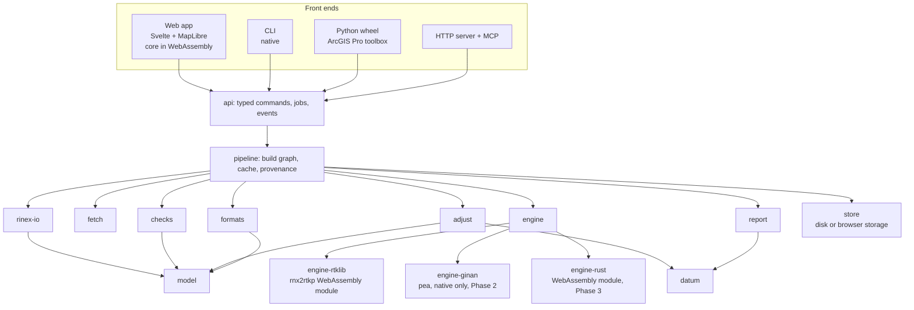
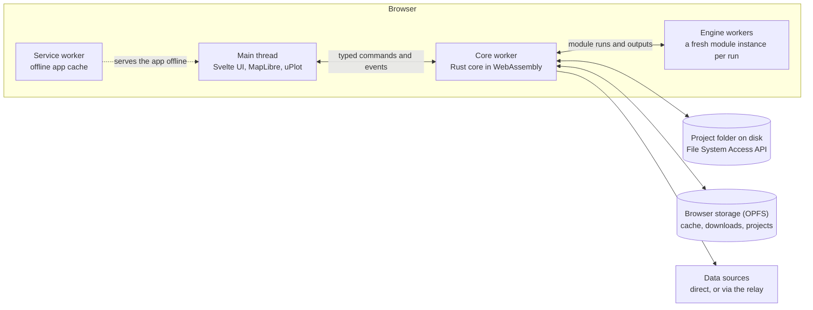

# Architecture

This is the technical design. The reasons behind the major choices are in [DECISIONS.md](DECISIONS.md), and the work breakdown is in [ROADMAP.md](ROADMAP.md). It's a living document: update it in the same PR as any change that departs from it.

## 1. Overview

All the logic lives in a Rust core. Each front end is a thin client of one typed command API, and baseline engines are swappable components behind a single interface.

The core is built two ways (D-023):

- **For the web app**, it's compiled to WebAssembly and runs entirely in the user's browser. This is the main front end. The site is static files, and project data never leaves the user's machine unless they export it or configure a destination.
- **Natively**, for the CLI, the Python bindings and the server. The CLI also runs the benchmark and serves the web app for offline use.

Engines run as WebAssembly modules, so the same engine binary runs in the browser and in the CLI.



## 2. Repository layout

```
crates/
  model/          domain types: marks, occupations, antennas, heights, sessions, baselines
  datum/          frames, epochs, transformations, plate motion, geoid, projections
  adjust/         least squares, testing, reliability, VCE, uncertainty, loop closures
  formats/        import/export: DynaML, STAR*NET, RTKLIB .pos, SINEX, LandXML, CSV, GeoPackage
  rinex-io/       RINEX ingest, header reconciliation, QC metrics
  fetch/          CORS data, orbits/clocks, ANTEX, site logs; cache; offline data packs
  engine/         BaselineEngine and ModuleHost traits, shared job/result types
  engine-rtklib/  RTKLIB-EX driver: config generation and output parsing
  engine-ginan/   Ginan driver (Phase 2); pea itself runs natively only
  engine-host/    runs engine modules natively with wasmtime
  checks/         blunder detection rules
  pipeline/       build graph, content-addressed cache, provenance, verify
  store/          storage interface: the file system natively; File System Access API and OPFS in the browser
  report/         standards evaluation and report generation
  api/            typed command API used by every front end
apps/
  web/            web app: core/ (the api crate compiled to WebAssembly) and ui/ (Svelte + TypeScript, workers, service worker)
  cli/            command-line interface; also serves the web app locally
  relay/          optional relay for data sources that browsers can't reach directly
  py/             PyO3 bindings and ArcGIS Pro toolbox (Phase 2)
  server/         axum HTTP server and MCP server (Phase 2)
packs/
  au/             Australian jurisdiction pack: frames, transformations, grids, standards, data sources
data/
  antennas/       antenna geometry catalogue (ARP and measure-up points, slant conversion)
engine-modules/
  rtklib-ex/      pinned source reference, WebAssembly build scripts, module checksums
benchmarks/       dataset manifests and runners (see VALIDATION.md)
docs/
```

Once the project is named (D-014), package names take a common prefix (for example `<name>-adjust`). The directory names stay short.

Every crate except `engine-host` compiles to both native code and WebAssembly. CI builds and tests both targets.

## 3. Crates

| Crate | Responsibility | Key dependencies |
|---|---|---|
| `model` | Domain entities, IDs, serialisation, schema versions | serde, toml, schemars |
| `datum` | Frames, epochs, Helmert transformations, plate motion, grids, geoid, projections | hifitime, nalgebra, libm, tiff |
| `adjust` | Least squares, statistics, reliability, VCE, uncertainty, loops | nalgebra, libm; its own block-sparse solver and distributions (D-025) |
| `formats` | Parsers and writers for exchange formats | quick-xml, csv; its own SQLite file writer for GeoPackage (D-026) |
| `antennas` | The antenna catalogue: IGS antenna and radome codes, reference points, drawings and calibrated pairs (`data/antennas`), and sourced slant-height geometry | serde_json, toml; the IGS files are built in |
| `rinex-io` | RINEX observation files (2.11, 3.0x, 4.0x) and Hatanaka decompression, read a line at a time; navigation files and broadcast orbits; header extraction, QC | none: our own reader (D-027) |
| `fetch` | Source registry, download, cache, data packs | reqwest (uses the browser's fetch in the web app), sha2 |
| `engine` | Engine and module host traits, job and result types | none of note |
| `engine-rtklib` | Config generation, output parsing | none of note |
| `engine-ginan` | YAML config, output parsing | serde_yaml |
| `engine-host` | Runs engine modules natively | wasmtime |
| `checks` | Rule framework and built-in checks | none of note |
| `pipeline` | DAG execution, hashing, cache, provenance. The executor is supplied by the host. | blake3; natively tokio and rayon |
| `store` | One interface for project, cache and download storage | natively std::fs; in the browser web-sys (File System Access API, OPFS) |
| `report` | SP1 evaluation, HTML/PDF reports | none yet: the M3 HTML report is one self-contained page written directly. minijinja templates and PDF (D-012) come with M12 |
| `api` | Request/response types, jobs, events. So far: building networks from imported files, exports, and M3's second-opinion projects | serde, toml, specta; wasm-bindgen for the web app |

Dependencies are pinned and reviewed. cargo-deny enforces the licence policy (D-005): no GPL, AGPL or LGPL code is linked into our binaries. Copyleft tools may only run as separate processes, or as separately built engine modules that talk to our code only through files and arguments (D-023). The web app's JavaScript dependencies follow the same policy, checked in CI.

## 4. Conventions

These are detailed in `docs/CONVENTIONS.md` (milestone M0). The essentials:

- **Units.** SI internally: metres, seconds and radians. Degrees appear only at I/O boundaries.
- **Coordinates.** ECEF (X, Y, Z) is the working representation. Geodetic and projected coordinates are derived views.
- **Frames and epochs.** Every position carries a `FrameId` and an `Epoch`. Combining positions across frames or epochs requires an explicit transformation. This is enforced by types where practical and by runtime checks otherwise.
- **Heights.** Heights are typed (`Ellipsoidal`, `Ahd`, `Avws` and so on) and record the model used.
- **Time.** Observation times use hifitime epochs in GPST. Frame epochs are decimal years, computed by a single documented function.
- **Covariances.** Full matrices in m². Never store only standard deviations where correlations exist.
- **Errors.** `thiserror` in libraries and `anyhow` only in binaries. Code never panics on user data, and the parsers are fuzzed to prove it.
- **Logging.** Structured logging with `tracing`. Provenance is a separate, durable record, not a log.
- **Numerics.** f64 throughout. Numeric paths iterate in a deterministic order (`BTreeMap` or `IndexMap`, never `HashMap`). Tolerances are defined centrally.
- **Host access.** The core never touches the file system, network, clock or threads directly. The host provides them through interfaces (`store`, the fetch client, the pipeline executor, the module host): the standard library natively, and browser APIs in the web app. This is what lets one core build for both targets.
- **Determinism (D-024).**
  - WebAssembly arithmetic is fully specified, so a given web build produces bit-identical outputs in every browser on every operating system. We don't enable relaxed SIMD, which isn't deterministic.
  - The core uses one maths library, the `libm` crate, on every target. So the CLI on every platform and the web app give bit-identical outputs for the same inputs. Golden tests check this natively and in the browser.
  - Engine modules are the same binary everywhere, carrying their own C library, so they give identical outputs for identical inputs in any browser and in the CLI. A native build of the same engine isn't equivalent: in the M0 spike, glibc builds of RTKLIB-EX made different fix decisions from the module on kinematic data.

## 5. Domain model

The model is built around occupations. A baseline is something derived from two overlapping occupations, not a primary input. This is what makes the blunder checks possible.

```rust
/// A physical survey mark.
pub struct Mark {
    pub id: MarkId,                    // e.g. "PM12345"
    pub name: Option<String>,
    pub kind: MarkKind,                // PermanentMark, Cors, Temporary, ...
    pub approx: Option<Geodetic>,      // rough position, used by identity checks
    pub known: Vec<KnownCoordinate>,   // control values: frame, epoch, covariance, source
}

/// One set-up of one receiver and antenna over one mark for one time span.
pub struct Occupation {
    pub id: OccupationId,
    pub mark: MarkId,
    pub receiver: Receiver,            // make, model, serial, firmware
    pub antenna: Antenna,              // IGS code, radome, serial, calibration source
    pub height: HeightMeasurement,     // method, measure-up point, value, evidence
    pub span: TimeSpan,
    pub rinex: Vec<RawFileRef>,        // immutable originals, referenced by hash
    pub field_log: Option<AssetRef>,
}

pub enum HeightMethod {
    Vertical { to: MeasurePoint },     // e.g. ARP
    Slant { to: MeasurePoint },        // converted using the antenna geometry catalogue
}

/// A processed vector between two occupations.
pub struct BaselineSolution {
    pub from: OccupationId,
    pub to: OccupationId,
    pub frame: FrameId,                // frame of the orbits used
    pub epoch: Epoch,                  // mid-point of the overlap
    pub dxyz: Vector3<f64>,            // ECEF, metres
    pub cov: Matrix3<f64>,             // m², as reported by the engine
    pub quality: BaselineQuality,      // fix status, ratio, % fixed, RMS, overlap
    pub engine: EngineId,              // name, version, module hash
}

/// What the adjustment consumes.
pub enum Observation {
    GnssBaseline(BaselineRef),
    GnssBaselineCluster(Vec<BaselineRef>, ClusterCovariance),
    PointCluster(Vec<MarkId>, PositionsWithCovariance),
    // Phase 3: HeightDifference, Distance, Direction, ZenithAngle
}
```

Sessions are derived by grouping overlapping occupations. Candidate baselines are derived from sessions, and independent baselines are then selected from the candidates (section 9.3).

## 6. Project format

A project is a folder. It's text-diffable, works in Git, and can be zipped and handed to someone else.

In the web app the folder is on the user's disk, opened through the File System Access API. In browsers without that API, the project lives in browser storage and moves in and out as a zip (section 14.2). Either way the format is the same.

```
my-survey/
  project.toml           # name, jurisdiction pack, target frame, standards spec, defaults
  marks.toml             # marks and known coordinates
  occupations/           # one TOML file per occupation
  raw/                   # original files, never modified
  raw.lock               # SHA-256 of every raw file
  fieldlogs/             # captured logs and photos
  overlays/              # recorded corrections (e.g. header fixes), each with a reason
  results/               # adjustments and reports (regenerable)
  provenance.jsonl       # append-only record of every run
  .cache/                # content-addressed derived data (git-ignored; in browser storage in the web app)
```

An occupation file looks like this:

```toml
schema = 1
id = "2026-10-14-PM12345-A"
mark = "PM12345"
start = "2026-10-14T00:12:00Z"
end = "2026-10-14T02:31:30Z"
rinex = ["raw/PM12345A.rnx"]

[receiver]
make = "Leica"
model = "GS10"
serial = "1234567"

[antenna]
igs = "LEIAS10"
radome = "NONE"
serial = "7654321"

[height]
method = "vertical"
to = "ARP"
value = 1.5320           # metres
measured_by = "CL"
photos = ["fieldlogs/2026-10-14-PM12345-A-tape.jpg"]
```

A correction to a raw file is an overlay, one file per correction in `overlays/`, named after its id. It names the raw file, says who made it, when and why, and gives only the values it replaces. RINEX ingest applies overlays in order of their ids:

```toml
schema = 1
id = "2026-10-15-PM12345A-antenna"
file = "raw/PM12345A.rnx"
reason = "The field log and tape photo show an AS10 at 1.532 m to the ARP; the header had the default antenna and no height"
by = "CL"
recorded = "2026-10-15T03:00:00Z"

[rinex]
antenna = "LEIAS10"
radome = "NONE"
antenna_delta = [1.532, 0.0, 0.0]   # height, east, north (metres)
```

Until the occupation model arrives (M5), a second-opinion project (M3) is `project.toml`, `raw/`, `raw.lock` and `results/`. The vectors and control it adjusts are files imported as they are, and the person's edits sit next to them with their reasons:

```toml
schema = 1
name = "Bright control survey"

[adjustment]
frame = "GDA2020"
datum = "constrained"        # or "minimal", or "fixed:MARK"
uncertainty = "a-priori"     # the variance factor PU and RU use, or "a-posteriori"
alpha0 = 0.001
beta0 = 0.8
global_alpha = 0.05

[[import]]
file = "raw/vectors.xml"
format = "dynaml"            # starnet, rtklib, csv-vectors, csv-control or sinex

[[import]]
file = "raw/control.csv"
format = "csv-control"
frame = "GDA2020"            # for formats that don't say

[[edit]]
observation = "vectors.xml:435"
action = "exclude"           # or "reweight", with a factor
reason = "Vector test 28.4; re-observed on day 2"
```

The rules:

- `raw/` is immutable. Every load verifies its hashes against `raw.lock`.
- Corrections, such as a wrong antenna height in a RINEX header, are overlays that record the reason. They're never edits to the raw files.
- Everything in `results/` and `.cache/` can be regenerated from the rest. The web app keeps `.cache/` in browser storage (OPFS) rather than in the folder, because writing many small files through the File System Access API is slow.
- Every file has a schema version, and migrations are automatic and logged.
- Each file has a JSON Schema (generated with schemars), so editors validate as you type. They're in the repository's `schemas/` folder: `project.schema.json`, `marks.schema.json`, `occupation.schema.json` and `overlay.schema.json`. A test fails if they fall behind the code; regenerate them with `GNSS_UPDATE_SCHEMAS=1 cargo test -p gnss-api --test schemas`. In VS Code with Even Better TOML, or any editor using Taplo, a `#:schema <url>` comment on a file's first line points it at its schema.
- Schema version 1 is the first, so there's nothing to migrate yet. A file with a newer version than the app reads is refused with a message saying so, rather than misread.
- The core reads and writes a project only through the `store` crate's `Store`: `FsStore` natively, and a `MemoryStore` the web app fills from the user's folder or browser storage. `gnss_api::folder::load` loads a project from either, reporting every problem by file.

## 7. Pipeline and provenance

Processing is a build graph, as in a build system:

```
ingest(raw) → normalise(occupation) → qc(occupation)
           → process(baseline, settings, engine) → vector set
           → adjust(config) → evaluate(standards) → report(template)
checks run as nodes alongside, wherever their inputs exist
```

- **Node keys** are `blake3(canonical inputs + upstream keys + settings + tool versions)`. Tool versions include the crate version, git hash, build target (web or native) and engine module hash.
- **The cache** lives in `.cache/<key>/`, holding outputs plus metadata. Garbage collection is by reachability from the current graph.
- **Execution** is supplied by the host. Every job supports cancellation and emits progress events.
  - Natively, tokio orchestrates, rayon handles CPU-bound maths, and engine modules run in a pool of wasmtime instances.
  - In the web app, the core runs in a dedicated worker and engine modules run in a pool of engine workers (section 14.1).
- **Incremental by construction.** Changing an antenna height invalidates that occupation's baselines and everything downstream of them, and nothing else.
- **Provenance.** Every run appends a JSONL record per node to `provenance.jsonl`: computed or cached, its key, the tool, the hash of its settings, its inputs (outside data as `name@hash`, upstream nodes as `node@key`), the hash of its output, and its duration when the host times it. Hashes are BLAKE3, written in full. For example (hashes shortened here):

```json
{"run":"2026-10-15T03:12:44Z","app":"0.3.0","build":"web","node":"baseline/A~B","status":"computed","key":"9c1e…","tool":"rtklib-ex 2.5.0 blake3:5d0e…","settings":"41fe…","inputs":["normalise/A@77ab…","normalise/B@12cd…"],"output":"5a90…","ms":4210}
```

- **Implemented so far** (`crates/pipeline`): the graph, checked for missing inputs and cycles and run in a fixed order (each node after its inputs, ties by id); BLAKE3 keys built field by field with lengths, so no two different inputs hash alike; the cache in `.cache/<2 hex>/<key>` through the `store` crate; progress events and cancellation between nodes, supplied by the host; and `verify`. Nodes run one after another for now; the parallel executors come with the work that needs them.
- **`verify`** re-runs the whole graph while ignoring the cache, then compares output hashes. This is the audit answer to "how did you get this number?" Hashes must match when the re-run uses the same build: the same web release on any operating system, or the same native build on the same platform. Across builds, outputs are compared numerically against the tolerances in section 4.

## 8. Command API and front ends

- The `api` crate defines a typed request/response pair for every operation, for example `ImportRinex`, `SetHeight`, `ProcessBaselines`, `Adjust`, `Explain`, `Export`.
- Long-running operations return a `JobId` and emit `JobProgress`, `JobFinished` and `IssueRaised` events (`gnss_api::jobs`). They're serialised with a `type` field, which is how the web app's worker posts them:

  ```json
  {"type":"progress","job":1,"done":2,"total":7,"step":"baseline/A~B"}
  {"type":"issue-raised","job":1,"file":"occupations/A.toml","message":"mark PM9 isn't in marks.toml; add it there first"}
  {"type":"finished","job":1,"outcome":{"status":"succeeded","computed":4,"cached":3}}
  ```
- **Transports:**

  | Transport | Used by |
  |---|---|
  | Worker messages (postMessage) | Web app: the UI on the main thread, the core in a dedicated worker |
  | In-process calls | CLI |
  | PyO3 | Python |
  | HTTP/JSON (axum) | Server |
  | MCP tools | Agents |

- TypeScript types are generated from the Rust types with specta, so the UI and core can't drift apart.
- **Rule: front ends contain no domain logic.** Anything a user can do in the UI can also be done through the CLI and Python, because they all call the same commands.

## 9. Baseline engines

### 9.1 Engine interface

```rust
pub trait BaselineEngine: Send + Sync {
    /// Name, version and module hash, recorded in provenance.
    fn id(&self) -> EngineId;
    /// Supported modes, constellations, frequencies and recommended baseline lengths.
    fn capabilities(&self) -> Capabilities;
    /// Turn one baseline job into module runs: arguments, config and input files.
    fn plan(&self, job: &BaselineJob) -> Result<Vec<ModuleRun>, EngineError>;
    /// Read the runs' outputs into an outcome.
    fn interpret(&self, job: &BaselineJob, outputs: &[ModuleOutput]) -> Result<BaselineOutcome, EngineError>;
}

/// Runs engine modules. Supplied by the host: engine workers in the browser, wasmtime natively.
pub trait ModuleHost {
    async fn run(&self, run: &ModuleRun, cx: &JobContext) -> Result<ModuleOutput, HostError>;
}
```

Engine drivers are pure. `plan` and `interpret` do no I/O and must be deterministic, so they can be tested without running anything, and they behave the same in both builds. Running the module is the host's job:

- A `ModuleRun` names the module by hash and lists its arguments, input files and expected outputs.
- A `ModuleOutput` holds the output files, stderr and exit status.
- One baseline usually needs several runs, for example the combined solution plus the forward-only and backward-only runs for the agreement check (section 9.3).

A `BaselineJob` carries:
- the normalised rover and base RINEX
- navigation data and products
- ANTEX
- the base coordinate, in the orbit frame at the observation epoch
- the reconciled antenna information
- the processing settings

A `BaselineOutcome` carries the solution, the quality metrics, a residuals reference, the engine log and the list of attempts.

### 9.2 Why WebAssembly modules

Engines run as separately built WebAssembly modules, rather than as linked libraries or native processes:

- **They run in the browser.** It's the only way to run C engines such as RTKLIB-EX there.
- **One binary everywhere.** The same module, identified by its hash, runs in every browser and in the CLI. WebAssembly's arithmetic is fully specified, so identical inputs give identical outputs on every host, and the CI benchmark validates the exact engine that users run.
- **Re-entrancy.** RTKLIB's post-processing keeps state in file-level globals, so one instance can't process several baselines at once. Each run gets a fresh instance with its own memory, which also resets that state. Parallelism comes from running instances in separate workers (or wasmtime instances). The module is compiled once and instantiated per run, which is cheap.
- **Crash isolation.** A malformed file can crash C code. Here, it traps one instance and fails one job, not the app. The host discards the instance and reports the failure.
- **Sandboxing.** A module sees only the files the host hands it, and has no network access.
- **Version pinning.** Each module has a hash, which is verified before use and recorded in provenance.
- **Licence hygiene.** Modules are built separately and talk to our code only through files and arguments, so the same boundary as for separate processes applies (D-005, D-023).

Native-only engines (Ginan, section 9.4) run as separate processes, which only the native hosts support.

### 9.3 RTKLIB-EX module

- **Build.** `rnx2rtkp` is compiled in CI from a pinned RTKLIB-EX tag to a single WASI module (`wasm32-wasip1`) with wasi-sdk, and its checksum is published. The web app serves it as a static asset, and the CLI embeds it. The only change RTKLIB-EX needs is a stub for `system()`, which it uses only to decompress inputs. The M0 spike confirmed the build: its results matched native builds byte for byte on 19 GA baselines, and were identical in Chromium, Firefox, WebKit and wasmtime ([report](spikes/m0-engine.md)).
- **Hosts.** In the browser, each engine worker runs the module through a small WASI shim. File reads are served from the input files in slices, so large files are never copied into memory whole, and outputs are collected in memory. Natively, wasmtime runs the module with a preopened temporary directory.
- **Inputs.**
  - Before each run, the driver trims each RINEX file to the overlap window and decimates it to the processing interval. RTKLIB keeps every epoch in its window in memory, so trimming and decimating keep a run well within WebAssembly's memory limit (4 GB at most per instance, and less on some devices).
  - Trimming also saves time. RTKLIB parses every line of an input file, even outside its time window. In the M0 spike, trimming roughly halved the run time in Chromium, without changing the solution.
  - Navigation data must cover every constellation being processed (section 13). The driver refuses to run otherwise.
  - The ANTEX file can be passed whole. Cutting it down to the antennas in use made no material difference to time or memory.
- **Config.** The driver generates one config file per baseline. The example below is illustrative; the option names are checked against RTKLIB-EX source, and the real values come from the project settings:

```ini
pos1-posmode      =static
pos1-soltype      =combined
pos1-frequency    =l1+l2
pos1-elmask       =15            # degrees
pos1-ionoopt      =brdc          # short baselines; longer ones use dual-freq or est-stec
pos1-tropopt      =saas          # longer baselines use est-ztd
pos1-navsys       =41            # bitmask: gps(1) + gal(8) + bds(32)
pos2-armode       =continuous
pos2-gloarmode    =off           # see D-019
pos2-arthres      =3
out-solformat     =xyz
out-solstatic     =single        # one final static solution
out-outstat       =residual      # residuals for the inspector
ant1-anttype      =*             # antenna type and deltas from the reconciled RINEX header
ant2-anttype      =*
ant2-postype      =xyz
ant2-pos1         =<X>           # base ECEF, in the orbit frame at the observation epoch
ant2-pos2         =<Y>
ant2-pos3         =<Z>
file-satantfile   =igs20.atx
file-rcvantfile   =igs20.atx
```

- **Header correctness matters.** Because `*` takes the antenna type and deltas from the RINEX header, the driver always feeds RTKLIB the *reconciled* RINEX (originals plus overlays), never the raw file.
- **Frames.** RTKLIB has no concept of frames. Transforming the base coordinate into the orbit frame and epoch is our job (section 11.2).

When parsing the output, watch for these:

- **Covariance signs.** In `.pos` output, the off-diagonal covariance columns (`sdxy`, `sdyz`, `sdzx`) are written as `sign(c)·sqrt(|c|)`. Recover the covariance as `c = sign(v)·v²`. RTKLIB's own solution reader squares these values and loses the sign, so don't copy that code.
- **Q flag.** 1 is fix, 2 float, 3 SBAS, 4 DGPS, 5 single, 6 PPP. Only Q=1 with a passing ratio counts as fixed.
- **Forward/backward agreement.** RTKLIB-EX only validates forward fixes against backward fixes in kinematic and moving-base modes, not static. The driver therefore also runs forward-only and backward-only solutions and compares them itself. Disagreement beyond their combined uncertainty marks the baseline as suspect. In the M0 spike, forward and backward solutions differed by up to 73 mm on baselines over 10 km, against formal 3D standard deviations of 1 to 3 mm.
- **Precision of the output.** Standard deviations and covariance terms are written in metres to four decimals. For sub-millimetre formal precisions, that loses up to about 10% of the value, and small correlations entirely. Decide in M8 whether to patch the output format in our build.
- **`out-solstatic=single`** gives one final solution with covariance. Per-epoch output (`all`) is only produced for the inspector.

**Baseline selection.** Within each session, choose independent baselines (n − 1 for n receivers) using one of these strategies:
- a minimum spanning tree weighted by length and data quality
- radial from the nearest CORS
- a user-defined set

Trivial baselines are excluded from the adjustment by default but kept for loop checks. All selections are recorded.

**Retries.** When a baseline doesn't fix, a documented ladder of variations is tried: raise the elevation mask, exclude satellites with high residuals, trim the time window. Each attempt is a separate pipeline node with its own provenance. The user sees what was tried and why the final result was chosen.

### 9.4 Ginan (Phase 2)

- Runs Ginan's `pea` executable as a native process in the CLI and server, with a generated YAML config.
- `pea` is a large C++ code base with heavy dependencies, so a WebAssembly build is investigated in M16 but not assumed. The web app reaches Ginan through a local `gnss serve` or an agency server that the user configures (sections 15 and 17).
- Used for single-site PPP (an offline equivalent of AUSPOS), long baselines through PPP-derived constraints, and products that need bias handling.
- Ginan is Apache-2.0, so linking would be allowed. We keep process isolation anyway, for crash isolation and version pinning.

### 9.5 Rust engine (Phase 3)

Our own engine, written in Rust, is a batch double-difference least squares solver for static sessions. It processes the whole session at once rather than filtering epoch by epoch, which suits static work better than RTKLIB's real-time-oriented Kalman filter. It also extends naturally to multi-baseline sessions with full correlations. Planned modules:

- observation modelling (PCO/PCV, troposphere, tides)
- cycle-slip detection
- float solution
- LAMBDA/MLAMBDA with partial ambiguity resolution and validation
- covariance realism

It's built as an engine module like RTKLIB-EX, so it runs the same way in the browser and the CLI. It only becomes the default once it matches or beats RTKLIB-EX on every benchmark gate.

## 10. Adjustment

### 10.1 Functional model

The unknowns are ECEF coordinates for each mark, plus nuisance parameters:
- set-up offsets per occupation
- later, optional per-group transformation parameters

A GNSS baseline from occupation *k* on mark *i* to occupation *l* on mark *j* is modelled as:

```math
\Delta X_{ij} = (X_j + \delta_l) - (X_i + \delta_k)
```

Here the vector has already been reduced to the marks using the antenna heights and calibrations. The δ terms are set-up errors (centring and height measurement), with zero-mean priors. A point cluster (control) observes `X_i` directly.

For GNSS-only networks the model is linear in ECEF, so no iteration is needed. Iteration arrives with VCE and, in Phase 3, with terrestrial observations.

Set-ups are optional: an element's ends can name the set-up they were measured from. Each set-up's error is a block of unknowns beside the marks', and its prior is a pseudo-observation that the error is zero, so it adds as many rows as unknowns and the degrees of freedom don't change. The prior is tested like any observation: a w-test per local axis and a 3-DoF test. A misread antenna height or an antenna off its mark shows there, on the set-up, rather than spread over its vectors. Inner constraints move the marks, not the set-up errors.

### 10.2 Stochastic model

- `Σ_ll = σ₀² Q_ll`, with `Q_ll` built from the engine covariances and per-group scale factors `k_g` (from VCE or set by the user).
- Set-up priors are rotated from local ENU to ECEF:

  ```math
  \Sigma_{\delta_k} = R_k^T \operatorname{diag}(\sigma_h^2, \sigma_h^2, \sigma_v^2) R_k
  ```

  Because δ is a parameter shared by every vector from that occupation, the vectors are correctly correlated through their common set-up. Defaults are documented and configurable per equipment type.
- Baseline clusters keep their full covariance.

### 10.3 Datum definition

GNSS vectors carry scale and orientation from the orbits, so a vector-only network has a 3-parameter translation defect.

- **Minimally constrained.** Fix one mark, or apply inner constraints on translation. The residuals and test statistics are invariant to which choice is made, and this invariance is a property test.
  - A fixed mark is held at its approximate position.
  - Inner constraints keep the centroid of the approximate positions. They're solved by holding one mark, then moving the solution to the centroid with an S-transformation, which costs three extra solves.
- **Constrained.** Control marks enter as weighted constraints with their covariance (point clusters), or as hard constraints if the user asks. Comparing constrained and minimally constrained solutions tests the consistency of the control: `ΔΩ = Ω_c − Ω_mc` is tested against χ² with (constraints − 3) degrees of freedom, and inconsistent control is reported by mark.

### 10.4 Solution

- **Normal equations.** `N = AᵀPA` and `u = AᵀPl` are built in 3×3 blocks, a block row per mark. Their pattern has a block wherever two marks share an observation.
- **Factorisation.** `N = L D Lᵀ` with block pivots, eliminating marks in minimum-degree order, with ties going to the lowest mark. This is our own code (D-025): every step is plain arithmetic in a fixed order, so results are the same bits natively and in the browser.
- **Parameter covariance `Q_x̂ = N⁻¹`.** The selected inverse (Takahashi recurrence) gives every block on the factor's pattern: each mark's own block and every pair of marks that share an observation. That's everything the statistics need, at about the cost of the factorisation, for networks of any size. Any other pair, such as RU between distant marks, costs three solves.
- **Residuals.** `v̂ = A x̂ − l`, adjusted minus observed, and `Q_v̂v̂ = Q_ll − A Q_x̂ Aᵀ`, of which only the per-observation blocks are needed.
- **Fit.** The weighted sum of squares is `Ω = v̂ᵀPv̂`, with *r* degrees of freedom.
- **Speed.** 1,000 marks and 3,000 vectors adjust, with all statistics, in 17 ms natively and 38 ms in Chromium. 10,000 marks and 30,000 vectors take 0.3 s natively.

### 10.5 Statistical testing

- **Global test.** `Ω/σ₀² ~ χ²(r)`, two-tailed, at its own level: 5% by default, as in the ICSM guideline and DynAdjust. It doesn't take its level from λ₀. The B-method would put it near 40% for a network with 100 degrees of freedom, so correct networks would fail routinely.
- **w-test (data snooping, σ₀ known).** For each alternative vector *c* (one per vector component, expressed in local ENU at the vector's first mark so results read as horizontal or vertical):

  ```math
  w = \frac{c^T P \hat v}{\sigma_0 \sqrt{c^T P Q_{\hat v \hat v} P c}} \sim N(0,1)
  ```

- **Standardised residuals.** Each ECEF component's residual over its own standard deviation, `v_k / (σ₀ sqrt(Q_v̂v̂,kk))`, ignoring correlations. This is DynAdjust's N-stat, kept for comparison with it. It equals the w-test only for uncorrelated components.
- **Vector test (3 DoF).** For vector *i*, with `C_i` selecting its three components:

  ```math
  T_i = \frac{\hat v^T P C_i \,(C_i^T P Q_{\hat v \hat v} P C_i)^{-1}\, C_i^T P \hat v}{\sigma_0^2} \sim \chi^2_3
  ```

- **Tau test (Pope)** is the w-test with the a posteriori variance factor, against Pope's critical value at α₀. It needs at least 2 degrees of freedom.
- **Critical values** follow Baarda's B-method. Choose α₀ (default 0.1%) and β₀ (default 80%), giving λ₀ ≈ 17.07. The 3-DoF test's level is derived from the same λ₀ and β₀ (0.55% for the defaults), so it's as sensitive as the w-test.
- **Untestable components.** A component that the other observations check less than 1e-8 of, such as a spur or bridge vector's, gets no w-test and no MDB: its residual is rounding error over rounding error, and the bias it could hide is unbounded.
- **Outlier handling.** Suspects are ranked by test statistic and shown with evidence. Excluding or re-weighting an observation is a recorded user action, and the tool never iterates silently.
  - Suspects are the failed w-tests and vector tests, ranked by how far they fail on a scale that grows with the bias: `|w|` over its critical value, or `sqrt(T)` over the square root of its critical value.
  - An edit names the observation, the action (exclude, or scale the covariance by a factor) and the person's reason. The edits travel with the results as the audit trail.
  - An excluded observation is compared with the network adjusted without it: its misclosures `d`, and per element `dᵀ(Q_ll + A Q_x̂ Aᵀ)⁻¹d / σ₀² ~ χ²(3)`, which says whether it would fit. For a single baseline this equals its vector test with it in, which the tests check.

### 10.6 Reliability

- **Redundancy numbers:** `r_i = (Q_v̂v̂ P)_ii`, which sum to *r*. They show how well each observation is checked by the others.
- **Minimal detectable bias:**

  ```math
  |\nabla_c| = \sigma_0 \sqrt{\frac{\lambda_0}{c^T P Q_{\hat v \hat v} P c}}
  ```

  For uncorrelated observations this reduces to `σ_i·sqrt(λ₀/r_i)`.
- **External reliability:** `∇x̂ = Q_x̂ AᵀP c ∇_c`, the largest coordinate shift that an undetectable blunder could cause. It's computed for the observation's own marks, relative to the datum: those blocks of `Q_x̂` are on the selected inverse's pattern, while shifts elsewhere would cost a solve per component.
- MDBs and external reliability are drawn on the map, so weak parts of the network are visible before anyone looks at a table.

### 10.7 Variance component estimation

Group scale factors are estimated with the simplified Helmert (Förstner) estimator and iterated to convergence:

```math
\hat k_g = \frac{\hat v_g^T P_g \hat v_g}{r_g}, \qquad r_g = \operatorname{tr}\big((Q_{\hat v \hat v} P)_{gg}\big)
```

Groups can be sessions, engines, receiver types or any other user-defined split. Each factor is reported with its redundancy. A warning is raised when a group has too little redundancy (r_g below about 10) for a meaningful estimate. The factors are the evidence for, or against, the realism of the engine covariances.

Observations in no group, such as control, keep their covariances as given. Each round re-adjusts with the new factors until every group's `Ω_g / (σ₀² r_g)` is within 1e-6 of 1, which takes 10 to 25 rounds on the synthetic networks. Every round's factors are kept as the convergence record.

### 10.8 Uncertainty and SP1

- Mark covariances come from `Q_x̂`, scaled per project policy (a priori or a posteriori variance factor). The policy is recorded.
- **Error ellipses.** Rotate the covariance to local ENU. The horizontal 2×2 block gives the standard error ellipse. The 95% ellipse scales it by `sqrt(χ²₂(0.95)) ≈ 2.4477`, and the vertical 95% value is `1.96·σ_u`.
- **Positional uncertainty (PU), per SP1 v2.2 section 4.2.** The horizontal PU is the 95% circular measure derived from the error ellipse, computed exactly as the ICSM *Guideline for Adjustment and Evaluation of Survey Control* specifies: `a(1.960790 + 0.004071c + 0.114276c² + 0.371625c³)`, with `c = b/a` from the standard ellipse (the same coefficients as GeodePy's `circ_hz_pu`). The vertical PU is `1.96·σ_u` (95%). PU is relative to the datum, so it includes control uncertainty, which comes naturally from weighted constraints.
- **Relative uncertainty (RU)** between marks *i* and *j* uses `Σ_Δ = Σ_ii + Σ_jj − Σ_ij − Σ_ji`, rotated to local ENU at mark *i*, with the same 95% measures. RU excludes datum uncertainty. It's available for any pair: `Σ_ij` comes from the selected inverse when the marks share an observation, and otherwise from three solves with the kept factorisation.
- **Error ellipsoids.** The 3D standard ellipsoid comes from the ENU covariance's eigenvectors, and the 95% one scales it by `sqrt(χ²₃(0.95)) ≈ 2.7955`.
- **AHD uncertainty** combines the ellipsoidal height uncertainty with the AUSGeoid2020 uncertainty at the mark, per SP1 section 4.2.2. The combination rule is defined in the jurisdiction pack.
- Jurisdiction-specific measures, such as Local Uncertainty where it's still published (for example in SCIMS), are computed by pack-defined evaluators.
- Every formula is checked against the guideline text and ICSM worked examples before v1.0 (M12).

### 10.9 Loop closures and repeat baselines

- **Loops.** Build a graph with marks as nodes and selected vectors as edges. A spanning tree gives a fundamental cycle basis: each non-tree edge closes exactly one loop. The misclosure is `w = Σ s_k ΔX_k` with signs from direction, and `Σ_w` comes from the loop vectors including any cluster correlations. Test `wᵀΣ_w⁻¹w ~ χ²(3)`, and report the misclosure in ENU (mm) and as ppm of loop length.
- **Repeat baselines.** Differences between repeated vectors over the same mark pair, tested the same way.
- Loops are a pre-adjustment screen and an aid to explanation. They don't replace the adjustment tests.
- The spanning tree is built breadth first along the vectors in order, over the first vector of each pair of marks, so the loops are the same every time. Both tests use the vector test's critical value (B-method), and `Σ_w` includes the correlations between vectors of a cluster, which matter: a base's error cancels in a loop of its own vectors.

## 11. Datums and geodesy

### 11.1 Frames, epochs and the transformation graph

- **A frame registry** with dynamic frames (ITRF2020, IGS20, ITRF2014, ATRF2014), which need an epoch, and static frames (GDA2020, GDA94), which have a fixed reference epoch.
- **A transformation graph.** Nodes are frames and edges are transformations. Each edge carries:
  - the method: Helmert 7, Helmert 14, plate motion, grid
  - its parameters and their source document
  - its validity area and time
  - its uncertainty
- **Explicit paths.** The tool finds a path, shows it, and records it in provenance. The datum panel in the app displays each step with its numbers.
- **Epoch changes go through a static frame.** Moving a coordinate in a dynamic frame to another epoch needs a model of how the ground moves. In Australia that's the plate motion model, so the path runs through GDA2020 (ATRF2014 at 2018.0, to GDA2020, to ATRF2014 at 2025.0). Elsewhere there's no path, and the tool says so.
- **Areas narrow the search.** Transformations defined only in part of the world, such as the Australian ones, are left out of the search when the position is outside their area.
- **Aliases are identities with a tolerance.** WGS 84 realisations, IGS20 and ATRF2014 are tied to the ITRF frames they're aligned with by identity transformations that carry the stated tolerance as uncertainty (for example 10 mm for WGS 84 (G2139) to ITRF2014, and 2 m for WGS 84 without a realisation).
- **Two kinds of uncertainty.** A position's own covariance is propagated through each step. The transformations' parameter uncertainty is common to every position transformed along the same path, so it doesn't affect vectors between them; it's reported separately, for absolute uncertainty only.
- **Reverse transformations** change the sign of every parameter, as EPSG defines them. For these small rotations that matches an exact inverse to under a micrometre.
- **Grid transformations** need a grid file, which the host supplies, so the built-in graph has only the analytic ones. A project that loads a grid gets a graph that prefers it (`TransformationGraph::with_preferred`): the grid is used wherever it covers the position, and the analytic transformation elsewhere. For GDA94 to GDA2020 that means ICSM's conformal and distortion grid over the mainland and Tasmania, and the conformal transformation on Christmas and Cocos Islands. The grid is 2D, so ellipsoidal heights come from the conformal transformation. The reverse direction is found by iteration, as PROJ does.

### 11.2 Default strategy for Australia (D-017, to be validated with GA)

1. **Processing.** Engines work in the frame of the orbits (IGS20, consistent with ITRF2020) at the observation epoch. Base coordinates are transformed into that frame and epoch before processing.
2. **Adjustment.** This happens in ATRF2014 at a project reference epoch, by default the mean observation epoch.
   - Vectors are transformed from IGS20 using the ITRF2020 to ITRF2014 parameters. The effect on short vectors is sub-millimetre, but it's applied for rigour.
   - GDA2020 control is brought to the reference epoch with the Australian Plate Motion Model, carrying its uncertainty.
3. **Output.** Coordinates are transformed to GDA2020 with the plate motion model. Heights go to AHD via AUSGeoid2020, or to AVWS. Grid coordinates are in MGA2020.
4. **Shortcut.** For short local projects, adjusting directly in GDA2020 is acceptable. The tool computes the difference between the two routes and shows it, so the choice is based on evidence.

### 11.3 Heights

- Ellipsoidal heights (GRS80) are the working quantity.
- AHD heights are computed through AUSGeoid2020, with its uncertainty. AVWS heights are computed through the Australian gravimetric quasigeoid.
- Every height records its kind and the model used. There is no untyped "height".
- A geoid model is tied to its frame: AUSGeoid2020 takes only GDA2020 positions, so a position in another frame has to be transformed first.
- N is interpolated bilinearly. At the edge of the model's coverage, where some of the four nodes have no value, the others are used with rescaled weights, as PROJ does.
- An AHD height's sigma combines AUSGeoid2020's (from its separate uncertainty grid) with the position's vertical sigma, and is unknown if either is.

### 11.4 Projections

- MGA2020 and MGA94 use Transverse Mercator via the Krüger n-series (Karney 2011, to eighth order), which is accurate to well under a micrometre across a zone.
- Point scale factor, grid convergence, and line and combined scale factors (including height) for ground-distance work. The line scale factor uses Simpson's rule over the point scale factors.
- Grid convergence uses the GDA2020 Technical Manual's sign: grid bearing = azimuth + γ, negative west of the central meridian in the southern hemisphere. PROJ and GeographicLib report the opposite sign.

### 11.5 Implementation (D-011)

- **Our own Rust code** for the analytic pieces: ECEF and geodetic conversions, Helmert 7 and 14, plate motion and Transverse Mercator. They're small, fast and easy to test, need no C dependency, and compile to WebAssembly unchanged.
- **Grids:** a Rust NTv2 and GeoTIFF grid reader for the GDA94 to GDA2020 grids and the geoid models. This avoids shipping PROJ, which would have to be built for every platform and for WebAssembly.
  - The host supplies a grid's bytes through `GridSource`, which reads at any offset: a file natively, a `File` or OPFS handle in the browser. The reader takes only what it needs (the headers, then the nodes around each point), so a 247 MB grid never has to fit in memory.
  - NTv2 is read directly. GeoTIFF is decoded by the `tiff` crate (deflate and LZW, predictors, tiles and strips), one tile at a time with a small cache, and interpreted with PROJ's conventions: tie point and pixel scale, `PixelIsPoint` or `PixelIsArea`, and GDAL's metadata for band roles, units, offsets, scales and subgrid names.
  - Subgrids nest as NTv2 defines; a point uses the densest one covering it. Interpolation is bilinear, in double precision.
  - Both readers are fuzzed in CI.
- **PROJ** serves as a test oracle, and optionally as a backend in native builds for jurisdictions whose transformations we haven't implemented ourselves.
- **Validation** is against GeodePy, PROJ and the GDA2020 Technical Manual examples (see [VALIDATION.md](VALIDATION.md)).

### 11.6 Jurisdiction packs

A pack is data, not code. It declares frames, transformations, grids, height models, standards and data sources. `packs/au/pack.toml` is version 0, with the frames, transformations, height models and grids; standards and data sources follow in M6 and M7. An excerpt:

```toml
[pack]
id = "au"
name = "Australia"
version = "0.1.0"

[frames]
target = "GDA2020"
adjustment = "ATRF2014"

[[transformations]]
name = "GDA94 to GDA2020 (2)"   # EPSG's name; the datum crate implements it
epsg = 8447
grid = "gda94-gda2020-conformal-and-distortion"
use = "GDA94 coordinates from the state and territory survey networks..."

[[height_models]]
name = "AUSGeoid2020"
epsg = 8451
frame = "GDA2020"
height = "AHD"
grid = "ausgeoid2020"
uncertainty = "ausgeoid2020-uncertainty"

[[grids]]
id = "ausgeoid2020"
kind = "geoid"
licence = "CC BY 4.0, Geoscience Australia"

[[grids.files]]                 # one grid can come in several formats
format = "ntv2"
file = "AUSGeoid2020_20180201.gsb"
url = "https://s3-ap-southeast-2.amazonaws.com/geoid/AUSGeoid/AUSGeoid2020_20180201.gsb"
sha256 = "aa40b895..."
bytes = 247277168
browser = "relay"               # no cross-origin headers (checked 2026-10-19)
```

- **Transformations are named, not parameterised.** Their parameters are in the datum crate, checked against EPSG and the oracles; the pack says which apply and when. The datum crate's pack test checks that every transformation and frame the pack names exists, with the same EPSG code, and that the crate has none the pack leaves out.
- **`browser`** says whether the web app can download a file directly, because the host sends cross-origin headers, or needs the relay or a data pack (section 13).
- **Grid files are fetched and hash-verified** rather than committed or bundled. ICSM's and Geoscience Australia's grids are CC BY 4.0, so the app could serve them itself, with attribution (to settle in M7).

## 12. Blunder checks

```rust
pub trait Check: Send + Sync {
    fn id(&self) -> &'static str;                  // e.g. "antenna.height.header-mismatch"
    fn run(&self, project: &ProjectView) -> Vec<Issue>;
}

pub struct Issue {
    pub check: &'static str,
    pub severity: Severity,             // Info, Warning, Error
    pub objects: Vec<ObjectRef>,        // marks, occupations, baselines, observations
    pub message: String,                // plain-English summary
    pub evidence: Evidence,             // the numbers (and plots) that justify it
    pub fix: Option<SuggestedFix>,      // an action the user can apply, recorded as an overlay
    pub fingerprint: Fingerprint,       // stable ID so suppressions survive re-runs
}
```

- Checks run as pipeline nodes, so they're cached and re-run when their inputs change.
- Errors block the adjustment unless they're suppressed. A suppression records a reason, who made it and when, and appears in the report.

The initial catalogue (M9):

| ID | Detects |
|---|---|
| `antenna.height.header-mismatch` | Field log height differs from the RINEX header |
| `antenna.height.implausible` | Height outside the plausible range for the method and equipment |
| `antenna.height.inconsistent-repeat` | Same mark and equipment with different heights across sessions, beyond tolerance |
| `antenna.type.header-mismatch` | Field log antenna or radome differs from the RINEX header |
| `antenna.type.invalid-igs-code` | Antenna or radome code not valid in IGS naming |
| `antenna.calibration.missing` | Antenna not in the ANTEX in use, with the expected bias |
| `antenna.calibration.mixed-types` | Different uncalibrated antenna types at the two ends of a baseline |
| `mark.identity.split` | One mark ID with positions metres apart (a swap or typo) |
| `mark.identity.merge` | Different mark IDs within a few centimetres (probably the same mark) |
| `mark.identity.known-coordinate` | Approximate position inconsistent with the mark's known coordinates |
| `session.overlap.insufficient` | Overlap too short for the baseline length, per benchmark-derived guidance |
| `session.time.anomaly` | Clock jumps, time-system mismatch, duplicate or overlapping files |
| `network.redundancy.none` | Marks or vectors with no redundancy |
| `network.reliability.weak` | MDB above the project specification |
| `network.control.disconnected` | Control marks not connected to the network |

## 13. Data fetch

- **Planner.** Given the occupations, it works out what's needed: CORS RINEX for each window, navigation data, orbits and clocks of the right latency, ANTEX and site logs.
- **Sources** come from the jurisdiction pack. For Australia the GA GNSS Data Repository is available through its Web API, the S3 bucket `s3://ga-gnss-data-rinex-v1` and SFTP. Global products come from IGS mirrors that don't need a login.
- **Browser access.** A browser can only download from a host that sends cross-origin (HTTP CORS) headers, so each source in a pack declares whether the web app can reach it directly. The CLI isn't affected, since it downloads from any source directly. SFTP isn't available from a browser at all. Checked on 2026-10-15:

  | Source | From the web app |
  |---|---|
  | GA Web API, its archive downloads (observation and navigation files) and the `ga-gnss-data-rinex-v1` bucket | Direct |
  | `files.igs.org` (ANTEX, IGS station files) | Relay or data pack |
  | The AUSGeoid2020 grid and its uncertainty grid on Geoscience Australia's S3 host | Relay or data pack |
  | PROJ-data on GitHub: the GDA94 to GDA2020 grid, and AUSGeoid2020's N without its uncertainty, as GeoTIFF (checked 2026-10-19) | Direct |
  | The BKG and IGN IGS mirrors | Unknown: no response to the test |

- **Relay.** Sources the browser can't reach go through an optional relay (`apps/relay`): a small, stateless proxy that forwards GET requests only to hosts declared in the packs, and keeps no logs or copies.
  - It's off by default. The relay sees which files are requested (station, date and product), which hints at where and when a survey happened, so the app says so before it's first used.
  - Agencies can host their own, the project may run a public instance, and `gnss serve` includes a private one on the user's own machine.
- **Navigation files must be mixed-constellation.** In the GA archive, many stations publish their daily broadcast navigation data as separate per-constellation files (GPS, Galileo, BeiDou, GLONASS, QZSS) rather than one mixed (`_MN`) file. A single per-constellation file leaves the engine without ephemerides for the other systems. In the M0 spike this silently produced degraded single-constellation solutions, or no solution at all. The planner therefore requests a mixed file, or merges a station's per-constellation files, and a check flags navigation data that doesn't cover every constellation being processed.
- **The Australian v1 workflow should need no relay.**
  - RINEX and broadcast navigation files come directly from GA. For baselines up to about 20 km, broadcast orbits should be adequate: their errors contribute roughly 0.1 ppm, a couple of millimetres at 20 km. The benchmark checks this.
  - ANTEX and the AUSGeoid2020 grid are served with the app, and cached on first use, if their licences allow redistribution (to confirm in M7). Otherwise they come through the relay or a data pack.
  - Precise orbits, clocks and biases, needed for Ginan and long baselines in Phase 2, come through the relay or a data pack.
- **Downloader.** Resumable, with checksums and retries with backoff. The CLI supports proxies through standard environment variables; the browser uses the system's proxy settings.
- **Cache.** A per-user cache shared across projects, keyed by content hash: in the user's cache directory natively, and in browser storage (OPFS) in the web app. Projects record exactly which files they used.
- **Offline data packs.** A zip containing the files plus a manifest of sources, hashes and licences. A pack is exported on a connected machine, from the web app or the CLI, and imported on an air-gapped one. Packs are also how to bring in sources the browser can't reach without using a relay.
- **Attribution.** Licence and attribution metadata follow the data into reports.

## 14. Web app

### 14.1 Runtime



- **The main thread only renders.** The core runs in a dedicated worker, so long jobs never freeze the UI.
- **Engine workers** form a pool sized to the machine's cores and memory. Each module is compiled once, and each run gets a fresh instance (section 9.2). Workers exchange inputs and outputs by message passing, transferring buffers rather than copying them. In the M0 spike, an RTKLIB-EX run used about 90 MB of module memory for a 2-hour session, and 228 MB for a whole day at 30 s. So phones and low-memory devices get a smaller pool.
- **No shared memory.** Shared-memory threads inside WebAssembly currently need a nightly Rust toolchain and cross-origin isolation headers, which restrict what a page can load and embed. v1 doesn't use them: baselines run in parallel across workers, and the core's maths runs single-threaded. Very large adjustments can use the CLI. We'll revisit this if the web performance targets need it.
- **Loading on demand.** The core, the engine modules and the PDF generator load when first needed, and come from the cache after that.

### 14.2 Storage and project folders

| Browser | Where projects live |
|---|---|
| Chrome, Edge | A folder on disk, opened with the File System Access API and edited in place. It works alongside Git and other tools. The browser may ask for permission again in a new session. |
| Firefox, Safari | Browser storage (OPFS). Projects are imported from a folder or zip and exported as a zip, because these browsers currently don't let a page write to a folder on disk. |

- The cache and downloaded data live in browser storage (OPFS) in every browser.
- Browsers can evict their storage, so the app requests persistent storage, shows how much it's using, and treats the folder on disk or an exported zip as the durable copy. Browser storage is working space, not a backup.
- Raw files are hash-verified on load as before (section 6). In a folder on disk other programs can change them, and the hashes catch that.
- Large files are read in slices, never loaded whole.
- Zips are made and read by the core (`gnss_store::zip`), so every browser and the CLI produce the same file. Export is deterministic: entries sorted by path, fixed timestamps, `.cache/` left out because it can be rebuilt. Import refuses paths that escape the project, encryption, ZIP64 and damaged entries (checked by CRC), and accepts a zip whose files sit in one top folder.
- A zip is imported as a new project in browser storage, named after the zip; it never overwrites one already there, whose raw files may be the only copy. Removing a project from browser storage asks first and suggests exporting it.
- Opening a project, from a folder or browser storage, loads it in the core worker exactly as the CLI loads a folder (section 6), so the same problems are reported, by file.

### 14.3 Offline use and installation

- A service worker caches each version of the app, so after the first visit it works without a network.
- Where the browser supports it (Chrome and Edge, and Safari through Add to Dock or Add to Home Screen), the app can be installed and opened like a desktop app.
- Air-gapped machines use a release bundle: the static site as a zip, with checksums and a signature (section 18). `gnss serve` serves it on localhost, which browsers treat as a secure context, so every feature works. Any intranet web server with HTTPS works too.

### 14.4 Browser support

- **Full support:** the current and previous major versions of Chrome and Edge on Windows, macOS and Linux. Windows is the primary platform, since most surveyors work there.
- **Supported, with browser storage instead of folders on disk:** current Firefox and Safari.
- **Field mode (M14):** Safari on iOS and Chrome on Android. The office workflow isn't designed for phones.
- **Required features:** WebAssembly with SIMD, web workers, OPFS, service workers, and WebGL for the map. The app checks for them on start and explains anything that's missing.

### 14.5 Interface

- **Stack:**
  - Svelte 5, TypeScript and Vite.
  - MapLibre GL JS for maps and uPlot for time series.
  - Custom canvas sky plots.
  - TanStack Table, virtualised, for large tables.
  - Typed messages to the core worker, with TypeScript types generated from the command API by specta.
- **Layout.** Map-centric, with docked panels: Project, Issues, Inspector, Adjustment and Jobs.
- **Views:**

  | View | Shows |
  |---|---|
  | Map | Marks, baselines by quality, ellipses, loops, MDB |
  | Timeline | Occupation Gantt chart; overlaps reveal baselines |
  | Baseline inspector | Residuals, sky plot, SNR, slips, attempts |
  | Issues | Blunder checks with fixes and suppressions |
  | Adjustment | Global test, w-test ranking, VCE factors, PU/RU against spec |
  | Datum | Step-by-step transformation working |
  | Report | Preview |

- **M3's page** is a single page for the second-opinion adjustment: files in, settings, adjust, suspects with exclusions and reasons, the report and the downloads. The core worker keeps the loaded files and the last adjustment, so exports don't adjust again. The views above arrive with the full app (M11).
- **Basemaps.** Providers are user-configurable, including ArcGIS basemap services with the user's own key. The app ships a small low-zoom world basemap as PMTiles, and supports offline PMTiles files. In offline mode, no tiles are fetched. Defaults respect provider usage policies (no bulk use of openstreetmap.org tiles).
- **State.** The UI holds view state only. Domain state lives in the core, is read through the API and is updated by events.
- **Accessibility.** Keyboard-first operation, screen reader labels, and light, dark and high-contrast outdoor themes.
- **Security.**
  - A strict Content Security Policy: scripts only from the app's own origin, plus `wasm-unsafe-eval` so WebAssembly can run. No inline scripts, third-party scripts or CDNs. Styles come only from the app's own origin, except the HTML report's one inline style, allowed by its SHA-256 hash so the page can show the report exactly as it's downloaded. The report is shown in a sandboxed frame and has no scripts.
  - Network requests go only to hosts declared in packs or added by the user, enforced in the fetch layer.
  - Untrusted files are parsed in WebAssembly inside workers, so a parser bug is contained by both WebAssembly and the browser's sandbox.

## 15. CLI

The CLI is the same core compiled natively. It's used for scripting and CI, the benchmark, batch work and very large networks, preparing data packs, and serving the web app locally. It runs the same engine modules as the web app through wasmtime, so its engine results match the web app's for the same inputs.

```
gnss init <dir> --pack au
gnss import rinex <files...> [--mark <id>]   # occupations from the headers; new marks added
gnss import fieldlog <files...>
gnss reconcile [--fix --by <name>]   # headers against occupations; overlays for what differs
gnss export-rinex [--output <dir>]   # corrected plain RINEX for delivery
gnss qc <files...> [--nav <files>]   # RINEX equipment, completeness, gaps, slips, multipath, elevation coverage
gnss import vectors <file> [--format dynaml|starnet|tdef|rtklib|csv]   # guessed if not given
gnss import control <file> [--format dynaml|csv|sinex]
gnss fetch                      # CORS data, products and ANTEX for all occupations
gnss check                      # run blunder checks
gnss process                    # baselines
gnss adjust [--minimal|--constrained]
gnss exclude <observation> --reason <text>   # the outlier workflow, recorded in project.toml
gnss report --format html|pdf
gnss export --format dynaml|starnet|landxml|gpkg|csv
gnss verify                     # re-run from scratch and compare output hashes
gnss bench run --manifest benchmarks/<manifest>.toml
gnss serve [--bundle <zip>]     # serve the web app on localhost, with a private relay
```

- The binary name follows the project name (D-014).
- Every command supports `--json`, and takes the project folder as `--project` (the current folder by default).
- **`serve`** serves the web app that ships with the CLI, or a given release bundle. A web app served this way can also hand native-only jobs, such as Ginan, to the CLI. It listens on localhost only, checks the `Origin` and `Host` headers, and requires a per-session token, so other websites can't use it.
- Exit codes:

  | Code | Meaning |
  |---|---|
  | 0 | Success |
  | 1 | Error |
  | 2 | The adjustment ran, but a statistical test failed or there was no redundancy to test with |
  | 3 | Blocking issues present |

## 16. Python and ArcGIS Pro (Phase 2)

- PyO3 bindings, built with maturin as abi3 wheels for Windows, macOS and Linux. They mirror the command API one to one.
- An ArcGIS Pro Python toolbox (`.pyt`) calls the Python API and uses arcpy to write:
  - marks as points
  - vectors as lines
  - error ellipses as polygons
  - a file geodatabase with domains and symbology
- Optional publishing to ArcGIS Online or Enterprise goes through the REST API (`applyEdits`). There's no dependency on the ArcGIS API for Python.

## 17. Server and MCP (Phase 2)

- **Agency deployments.** The web app is static files, so any web server can host it internally.
- **An axum server** exposes the command API over HTTP/JSON, with authentication and multiple projects. It's for headless and batch processing, and for native-only engines such as Ginan. The web app sends jobs to it only when the user configures it.
- **An MCP server** exposes read and analysis tools, for example:
  - list issues
  - explain an observation's test statistics
  - summarise QA
  - propose fixes

  Any write action requires explicit user approval and is recorded in provenance like any other change.

## 18. Distribution, versions and updates

- **Web app.** Vite builds the UI, and the core and engine modules are compiled to WebAssembly. The result is static files. The host must let us set response headers, for the Content Security Policy now, and for cross-origin isolation if shared-memory threads are adopted later. Cloudflare Pages and Netlify allow this; GitHub Pages doesn't. It's served by Cloudflare Pages, uploaded by CI: the bundle CI built and tested is what's deployed, and Cloudflare never builds it (`docs/DEPLOYING.md`).
- **Versions.**
  - Each release is deployed at its own permanent URL (`/v/<version>/`) and never changed or removed. The site root serves the latest release.
  - Every release is also published as a bundle: the static site as a zip, with checksums, an SBOM and a signature (Sigstore, from CI).
  - Provenance records the app version and module hashes. When a project was last processed by a different version, the app says so and offers to open it in that version.
  - All versions share the site's browser storage, so schema versions are checked on every open (section 6), and an older version refuses a newer project rather than misreading it.
- **Updates.** A new version is announced in the app and takes effect on reload, never in the middle of a job. Air-gapped installations change only when someone installs a new bundle.
- **CLI:** cargo-dist, or a plain GitHub Actions matrix, builds archives and installers for each platform, with checksums. Signing the CLI binaries (SignPath for Windows, notarisation for macOS) is a v1.0 goal but not a blocker, since the web app is the main way in.
- **Supply chain:**
  - an SBOM per release, covering the Rust crates (cargo-cyclonedx) and the JavaScript packages
  - cargo-deny and cargo-audit in CI, plus licence and advisory checks for JavaScript packages
  - engine modules built from pinned source in CI
  - every asset served from the app's own origin, with no CDNs
  - reproducible builds as a goal

## 19. Security and privacy

- **Threats:**
  - untrusted input files (RINEX, vectors, field logs, products)
  - downloaded content
  - engine modules, and native binaries such as Ginan's `pea`
  - tampering with the web app, through its host or its dependencies
  - sensitive coordinates
- **Mitigations:**
  - memory-safe parsers with size limits, fuzzed in CI (cargo-fuzz)
  - parsers and engines run in WebAssembly inside workers, within the browser's sandbox
  - engine module hashes verified before use
  - network access only to hosts declared in packs or by the user
  - a strict Content Security Policy, and no third-party scripts
  - immutable versioned deployments, and signed bundles for users who need to verify exactly what they run
  - `gnss serve` listens on localhost only and rejects requests from other origins
  - a true offline mode
- **Privacy:**
  - no telemetry and no analytics scripts
  - projects stay on the user's machine; the static host sees page requests like any website, never project data
  - the relay is off by default, and the app explains what it can see before it's first used
  - nothing is uploaded anywhere unless the user explicitly configures a destination
- **Process:** SECURITY.md with private vulnerability reporting, and a threat model doc maintained from M13.

## 20. Performance targets

These are for an 8-core laptop. Web targets are for current Chrome or Edge, with the core's maths single-threaded (section 14.1).

The engine targets come from the M0 spike's measurements ([report](spikes/m0-engine.md)). With trimmed inputs, RTKLIB-EX took 1.2 to 2.3 s per 2-hour baseline in Chromium, 1.1 to 1.5 times native.

The adjustment targets are met with a wide margin (section 10.4). A synthetic network of 1,000 marks and 3,000 vectors adjusts in 17 ms natively and 38 ms in Chromium, about 2.2 times native. 10,000 marks and 30,000 vectors take 0.3 s natively. CI checks the first target natively and in headless Chrome on every change. The ingest target stays provisional until M6.

| Operation | Native CLI | Web app |
|---|---|---|
| Adjust 1,000 marks and 3,000 vectors, including statistics | under 2 s | under 6 s |
| Adjust 10,000 marks with selected inverse | under 60 s | under 5 min |
| Process 50 baselines (2 h at 30 s) with RTKLIB-EX | under 30 s | under 1 min |
| Process one whole-day baseline (24 h at 30 s) with RTKLIB-EX | under 20 s | under 30 s |
| Engine module memory per run: 2 h session, whole day at 30 s | n/a | under 128 MB, under 256 MB |
| Ingest and QC a 24 h, 1 Hz RINEX 3 file | under 10 s | under 30 s |
| Map with 10,000 marks and 30,000 vectors | n/a | smooth pan and zoom |
| Start-up | n/a | under 2 s from cache; under 10 s on a first visit over a 25 Mbit/s connection |

## 21. Testing strategy

| Layer | Approach |
|---|---|
| Unit | Per crate, close to the code |
| Property | proptest: transformation round trips, covariance propagation, invariance of test statistics to minimal constraints |
| Golden files | Parsers, writers and reports compared against reviewed outputs |
| Oracles | DynAdjust (adjustment), GeodePy and PROJ (datums), RTKLIB-EX (Rust engine, Phase 3) |
| Build parity | The same tests run on the native build and on the WebAssembly build in a headless browser (wasm-bindgen-test). Results agree within the tolerances in section 4, and engine modules give identical output hashes in wasmtime and in browsers. |
| Benchmark | Engine accuracy and reliability against known truth ([VALIDATION.md](VALIDATION.md)) |
| Fuzzing | Every parser, in CI |
| UI | Component tests with a mocked core, and end-to-end tests with Playwright in Chromium, Firefox and WebKit |
