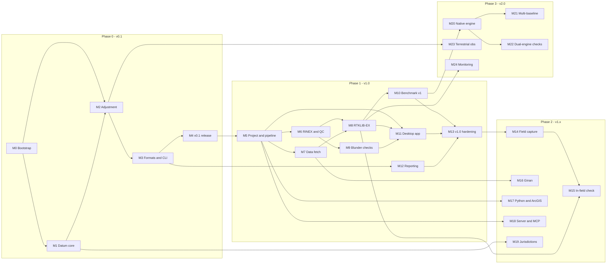

# Roadmap

This is the work plan: four phases broken into milestones, each with tasks, exit criteria, dependencies and a size. The reasons behind it are in [PLAN.md](PLAN.md), and the technical detail in [ARCHITECTURE.md](ARCHITECTURE.md).

## How to read this

- **Phases** group milestones by release: Phase 0 leads to v0.1, Phase 1 to v1.0, Phase 2 to v1.x, and Phase 3 to v2.0.
- **Milestones** (M0 to M24) are shippable increments. Each one has a goal, tasks, exit criteria and dependencies.
- **Sizes** are rough effort for one experienced developer:

  | Size | Effort |
  |---|---|
  | S | Days |
  | M | 2 to 4 weeks |
  | L | 1 to 3 months |
  | XL | More than 3 months |

- **Exit criteria** are the definition of done. A milestone isn't done until they're met, whatever the task list says.
- Task boxes are meant to be ticked here, or turned into GitHub issues under matching milestones.

## Start here: the first ten tasks

1. [ ] Pick the project name and check crates.io, PyPI, domains and trademarks (D-014, M0).
2. [ ] Add LICENSE (Apache-2.0) and CONTRIBUTING with DCO sign-off (D-008, M0).
3. [ ] Create the Cargo workspace and the CI matrix with cargo-deny (M0).
4. [ ] Write the conventions doc covering units, frames, time, errors and numerics (M0).
5. [ ] Implement the `datum` core types so every position carries a frame and an epoch (M1).
6. [ ] Implement ECEF, geodetic and ENU conversions plus Helmert transformations, with property tests (M1).
7. [ ] Build the synthetic network generator, which the M2 tests depend on (M2).
8. [ ] Implement a vector-only adjustment with minimal constraints and the global test (M2).
9. [ ] Install DynAdjust locally and produce the first oracle outputs (M2, M4).
10. [ ] Contact GA (the Ginan and DynAdjust teams) and one university about the benchmark (Community).

## Dependency graph

The critical path to v1.0 is M0 → M1 → M2 → M3 → M4 → M5 → M6 → M8 → M10/M11 → M13. Validation work (oracles, then the benchmark) runs alongside from M2 onwards.

---

## Phase 0: Foundations and the second-opinion adjustment (v0.1)

The goal is a CLI that rigorously adjusts imported GNSS vectors and reports the results. It's useful from day one to anyone who already has vectors, and it doesn't require anyone to trust our baseline processing.

### M0 Bootstrap [S]

**Goal:** a repo people can build, test and contribute to.

- [ ] Choose the project name and check for conflicts (D-014).
- [ ] Add LICENSE and NOTICE (Apache-2.0, D-008).
- [ ] Create the Cargo workspace with empty crates per [ARCHITECTURE.md](ARCHITECTURE.md#2-repository-layout). Pin the stable toolchain in `rust-toolchain.toml` and use edition 2024.
- [ ] Set up CI in GitHub Actions on Windows, macOS and Linux: `cargo fmt --check`, `cargo clippy -D warnings`, `cargo test`.
- [ ] Add cargo-deny for licences, advisories, bans and sources. Deny GPL, AGPL and LGPL. Allow-list MPL-2.0 (D-005).
- [ ] Write CONTRIBUTING.md (DCO sign-off), CODE_OF_CONDUCT.md (Contributor Covenant), SECURITY.md, and issue and PR templates.
- [ ] Write `docs/CONVENTIONS.md`: units, frames, epochs, time scales, covariance storage, error handling, logging, numerics and determinism.
- [ ] Add an ADR template for decisions too big for the log.
- [ ] Set up a GitHub project board with milestones M0 to M13 and labels (`area/*`, `type/*`, `good first issue`).

**Exit criteria:** CI is green on all three operating systems with the empty crates. The licence, contribution docs and board are in place.

### M1 Datum and geodesy core [M]

**Goal:** frames, epochs and transformations that are correct by construction.

- [ ] Time: adopt hifitime. Handle GPST, UTC and TAI conversions with leap seconds. Compute decimal-year epochs in one documented function.
- [ ] Core types:
  - [ ] `FrameId` with a registry covering ITRF2020, ITRF2014, IGS20, ATRF2014, GDA2020, GDA94, and WGS84 realisations as aliases with a stated tolerance.
  - [ ] `Epoch`, and `Position { frame, epoch, xyz, cov }`.
  - [ ] Geodetic and ENU views.
  - [ ] Enforce the static-frame and dynamic-frame rules.
- [ ] Ellipsoids (GRS80, WGS84): ECEF to geodetic and back, and local ENU rotations, each with covariance propagation.
- [ ] Helmert transformations:
  - [ ] 7-parameter and 14-parameter (time-dependent), with covariance propagation.
  - [ ] IERS ITRF2020 to ITRF2014 parameters.
- [ ] Plate motion: ITRF2014 and ATRF2014 to GDA2020 using the Australian Plate Motion Model from the GDA2020 Technical Manual.
- [ ] GDA94 to GDA2020: the 7-parameter conformal transformation and the conformal-plus-distortion NTv2 grid. Document which to use when.
- [ ] Grids:
  - [ ] NTv2 and geoid grid interpolation.
  - [ ] AUSGeoid2020 to convert ellipsoidal heights to AHD, including the model's uncertainty values.
  - [ ] Decide between a native reader and PROJ (D-011).
- [ ] Projections: MGA2020 and MGA94 (Transverse Mercator via the Krüger series), point scale factor, grid convergence and combined scale factor.
- [ ] Australian jurisdiction pack v0 (`packs/au`): frames, transformations, and grid references with URLs and SHA-256 hashes.
- [ ] Tests:
  - [ ] Property tests for round trips and covariance propagation.
  - [ ] Comparisons against GeodePy and PROJ on a published point set.
  - [ ] GDA2020 Technical Manual worked examples.
- [ ] User doc: "How datums and epochs work in this tool".

**Exit criteria:**
- Analytic transformations agree with GeodePy and PROJ within 0.1 mm, and grid transformations within 1 mm.
- Every public position type carries a frame and an epoch.

**Depends on:** M0.

### M2 Adjustment engine [L]

**Goal:** a rigorous, explainable 3D least squares adjustment of GNSS observations.

- [ ] Observation types:
  - [ ] GNSS baseline: a 3D vector with a 3×3 covariance.
  - [ ] GNSS baseline cluster: n vectors with a full 3n×3n covariance.
  - [ ] Point cluster: positions with covariance, for CORS, AUSPOS or control constraints.
- [ ] Stochastic model:
  - [ ] Input covariances, an a priori variance factor, and group scale factors.
  - [ ] Centring and height-measurement errors as occupation-level nuisance parameters with priors, so vectors that share a set-up are correctly correlated.
- [ ] Datum definition:
  - [ ] Minimally constrained, by fixing one station or using inner constraints.
  - [ ] Constrained, with fixed or weighted control.
  - [ ] An explicit frame and epoch for the adjustment.
- [ ] Solver:
  - [ ] Sparse normal equations with fill-reducing ordering and Cholesky factorisation (faer), plus a dense path for small networks.
  - [ ] Parameter covariance: a full inverse up to about 2,000 marks, and a selected inverse beyond that.
- [ ] Diagnostics: detect disconnected sub-networks, an undefined datum and near-singular geometry, with errors that name the marks involved.
- [ ] Statistics:
  - [ ] Residuals, the a posteriori variance factor and the global test (two-tailed χ²).
  - [ ] Redundancy numbers and standardised residuals.
  - [ ] w-tests in local ENU per component, plus a 3-DoF test per vector, with the tau test as an option.
- [ ] Reliability:
  - [ ] Minimal detectable bias (MDB) per observation, using Baarda's B-method with configurable α₀ and β₀.
  - [ ] External reliability: the effect of an undetected MDB on coordinates.
- [ ] Variance component estimation by group (session, engine, receiver type), iterated, with convergence reporting.
- [ ] Uncertainties:
  - [ ] Standard and 95% error ellipses and ellipsoids.
  - [ ] SP1 v2.2 positional uncertainty (PU) and relative uncertainty (RU) between any pair, following the ICSM *Guideline for Adjustment and Evaluation of Survey Control*.
- [ ] Loop closures (fundamental cycles from a spanning tree) and repeat-baseline comparisons, with misclosure tests and ppm.
- [ ] Outlier workflow:
  - [ ] Rank the suspects.
  - [ ] Exclude or re-weight with an audit trail.
  - [ ] Nothing happens automatically without a record.
- [ ] Results model: adjusted coordinates with covariance, residuals and statistics, ready for reporting.
- [ ] Tests:
  - [ ] Synthetic networks with known truth.
  - [ ] Blunder injection, measuring detection power against MDB theory.
  - [ ] Invariance: test statistics must not depend on which minimal constraint is chosen.
  - [ ] DynAdjust oracle comparisons.

**Exit criteria:**
- The adjustment matches DynAdjust on the oracle networks within 0.1 mm for coordinates and 0.1% for the variance factor, and flags the same outliers.
- Detection power on synthetic blunders is consistent with theory.
- A network of 1,000 marks and 3,000 vectors adjusts in under 2 s on a laptop.

**Depends on:** M0, M1.

### M3 Formats and CLI [M]

**Goal:** get vectors in and results out, without a GUI.

- [ ] Import vectors:
  - [ ] DynaML: GNSS baselines (type G) and baseline clusters (type X).
  - [ ] STAR*NET GPS vector files.
  - [ ] RTKLIB `.pos` files: the static single solution, recovering the signed covariance terms.
  - [ ] A documented generic CSV vector format.
- [ ] Import control:
  - [ ] DynaML stations and point clusters (type Y).
  - [ ] CSV with frame, epoch and uncertainty.
  - [ ] AUSPOS SINEX: coordinates with covariance.
- [ ] Document export recipes from TBC, Infinity, MAGNET, CHC Geomatics Office and Emlid Studio: which of our formats each can produce, and how.
- [ ] Export:
  - [ ] DynaML, for DynAdjust cross-checks and agency submission.
  - [ ] STAR*NET.
  - [ ] CSV.
  - [ ] GeoPackage: marks, vectors and error ellipses.
  - [ ] LandXML control points.
- [ ] CLI commands: `init`, `import`, `adjust`, `report`, `export`.
  - [ ] A `--json` output mode.
  - [ ] A non-zero exit code when statistical tests fail, so the CLI can be used in scripts and CI.
- [ ] HTML report v0:
  - [ ] Network summary, statistics and outlier table.
  - [ ] Coordinates with PU, the RU table and loop closures.
  - [ ] Provenance.
- [ ] Round-trip tests for every format, and fuzz targets for every parser.

**Exit criteria:** someone with vectors from a commercial package (exported in a supported format or CSV) can run a second-opinion adjustment and get a report.

**Depends on:** M2.

### M4 v0.1 release [S]

**Goal:** the second-opinion tool in real users' hands.

- [ ] Oracle suite in CI: DynAdjust outputs stored as golden files, plus a manual job to regenerate them.
- [ ] Documentation: a user guide for the CLI second-opinion workflow, and a worked example on public data.
- [ ] Release binaries for Windows, macOS and Linux, with checksums and an SBOM. Build with cargo-dist or a plain Actions matrix, and generate the SBOM with cargo-cyclonedx.
- [ ] Announce to pilot users and partners, and collect feedback as issues.

**Exit criteria:** v0.1 is tagged, and at least three external users have run it on real data.

**Depends on:** M3.

---

## Phase 1: Full static workflow (v0.3, v0.5 beta, v1.0)

The goal is to go from RINEX and field logs to an adjusted, reported control survey in a desktop app, with blunder checks and a published benchmark.

### M5 Project model and pipeline [L]

**Goal:** an occupation-first project folder and a cached, reproducible build graph.

- [ ] Domain model:
  - [ ] Mark, Receiver and Antenna (IGS code, radome, serial, calibration source).
  - [ ] HeightMeasurement (method, value, measure-up point, measured by, photos).
  - [ ] Occupation, Session (derived), Baseline, Observation and AdjustmentConfig.
- [ ] Project folder format per [ARCHITECTURE.md](ARCHITECTURE.md#6-project-format):
  - [ ] TOML, with one file per occupation.
  - [ ] An immutable `raw/` directory with hashes.
  - [ ] Overlays for corrections.
  - [ ] JSON Schema for every file.
  - [ ] Schema versioning and migrations.
- [ ] Antenna geometry catalogue (`data/antennas`): ARP, measure-up points, and the radius and offsets needed for slant-height conversion, with sources cited. This information isn't in ANTEX. Document how to contribute to it.
- [ ] Pipeline:
  - [ ] A DAG of steps: ingest → QC → baseline → vector set → adjustment → evaluation → report.
  - [ ] Node keys = hash(inputs, settings, tool versions), with a content-addressed cache.
  - [ ] Parallel execution, cancellation and progress events.
- [ ] Provenance:
  - [ ] An append-only JSONL record of every run: inputs, settings, versions, outputs and timing.
  - [ ] A `verify` command that re-runs everything and compares hashes.
- [ ] Command API (`api` crate): typed requests and responses for every operation, plus a job model for long-running work.

**Exit criteria:**
- Changing one antenna height re-runs only the dependent nodes.
- `verify` reproduces a project bit for bit on the same platform.

**Depends on:** M4.

### M6 RINEX ingest and QC [M]

**Goal:** trustworthy observation data and the metadata to check it.

- [ ] Integrate the `rinex` crate (nav-solutions; pin the version and confirm its licence) for RINEX 2.11, 3.0x and 4.0x, including Hatanaka compression. Wrap it behind our own trait so the parser can be swapped.
- [ ] Header extraction: marker, receiver, antenna and radome, antenna deltas (H/E/N), approximate position, interval, time span and observation types.
- [ ] Occupation detection: split and merge files, and detect gaps and multiple occupations within one file.
- [ ] Header reconciliation against field logs (this feeds M9). Write corrected RINEX on export, and never overwrite raw files.
- [ ] QC metrics:
  - [ ] Observations per satellite and signal, and completeness.
  - [ ] Cycle slips (geometry-free and Melbourne-Wübbena).
  - [ ] Multipath (code minus carrier).
  - [ ] SNR statistics, elevation coverage and data gaps.
  - [ ] Check all of these against Anubis and teqc-style reference outputs.
- [ ] Open receiver formats (UBX, SBF, Unicore, NovAtel, RTCM3): decide between calling `convbin` from RTKLIB-EX and native Rust decoders (D-020).

**Exit criteria:**
- The benchmark corpus ingests with QC metrics within tolerance of the reference tools.
- Fuzzed malformed files never crash the app.

**Depends on:** M5.

### M7 Data fetch [M]

**Goal:** no more data chasing.

- [ ] Source registry, driven by the jurisdiction pack:
  - [ ] GA GNSS Data Repository (Web API, S3 and SFTP) for CORS RINEX and site logs.
  - [ ] State CORS networks, where they're openly available.
  - [ ] IGS product mirrors that don't need a login.
  - [ ] ANTEX (igs20.atx).
- [ ] Nearest-CORS suggestions ranked by distance and by data availability in the occupation window.
- [ ] Products: broadcast navigation, plus precise orbits and clocks (final, rapid or ultra-rapid, chosen by latency). Record product versions in provenance.
- [ ] Downloads:
  - [ ] A cache with checksums.
  - [ ] Resumable downloads and proxy support.
  - [ ] Offline data packs: export and import a bundle for air-gapped machines.
- [ ] Use site logs to check CORS antenna and receiver history against RINEX headers.
- [ ] Respect data licences, and carry attribution (for example CC BY for GA data) into reports.

**Exit criteria:**
- Given a set of occupations, one command fetches everything needed.
- It works behind a proxy, and fully offline with a data pack.

**Depends on:** M5.

### M8 RTKLIB-EX baseline processing [L]

**Goal:** reliable static baselines with honest quality information.

- [ ] Sidecar build:
  - [ ] Pin an RTKLIB-EX release.
  - [ ] Build `rnx2rtkp` from source in CI for Windows x64, macOS arm64 and x64, and Linux x64 and arm64.
  - [ ] Publish checksums, and record the version and hash in provenance.
- [ ] Config generation from project settings ([details](ARCHITECTURE.md#93-rtklib-ex-sidecar)):
  - [ ] Static mode with a combined solution.
  - [ ] Frequencies and constellations.
  - [ ] Elevation and SNR masks.
  - [ ] Ionosphere and troposphere options chosen by baseline length.
  - [ ] Ambiguity resolution mode and thresholds.
  - [ ] Antenna types, deltas and ANTEX.
  - [ ] The base position from known coordinates.
- [ ] Job runner: one process per baseline, a parallel pool, timeouts, stderr capture and crash handling.
- [ ] Output parsing:
  - [ ] The final solution and its covariance, including the signed off-diagonal terms.
  - [ ] Q flag, ratio and satellite count.
  - [ ] Residuals from `.stat` for the inspector.
- [ ] Forward/backward agreement check. RTKLIB-EX doesn't validate this in static mode, so the driver runs forward-only and backward-only solutions and compares them.
- [ ] Baseline selection:
  - [ ] Independent baselines per session, using a minimum spanning tree by length or radial from CORS.
  - [ ] Exclude trivial baselines.
  - [ ] Allow user overrides.
- [ ] Base position seeding: use the best-known coordinates (control, CORS, PPP or AUSPOS, or an iterated solution). Warn when the base is poorly known.
- [ ] Retry strategies: documented variations (elevation mask, satellite exclusion, time window) when a baseline fails to fix. Record every attempt in provenance.
- [ ] Baseline quality model:
  - [ ] Inputs: fix status, ratio, percentage fixed, residual RMS, data overlap and length.
  - [ ] Classification as good, suspect or failed, with reasons.
- [ ] CLI `process` command. With this, v0.3 is end to end in the CLI.

**Exit criteria:**
- The CORS-pair benchmark subset processes at the expected fix rates.
- Results feed the adjustment with covariances.
- A failed baseline is explained, not just flagged.

**Depends on:** M6, M7.

### M9 Blunder checks [M]

**Goal:** catch the errors that actually wreck surveys.

- [ ] Rule framework: each check has an ID, severity, explanation, evidence, a suggested fix and links to the affected objects. Suppressions are recorded with a reason, who made them and when.
- [ ] Antenna height:
  - [ ] Field log against the RINEX header.
  - [ ] Slant-to-vertical conversion.
  - [ ] Implausible values.
  - [ ] The same mark with different heights across sessions.
- [ ] Antenna type:
  - [ ] Field log against the header.
  - [ ] Validity of the IGS code and radome.
  - [ ] Antennas missing from ANTEX, with the expected bias.
  - [ ] Mixed antenna types on a baseline without calibrations.
- [ ] Mark identity:
  - [ ] The same ID with positions metres apart (a swap or typo).
  - [ ] Different IDs within a few centimetres (probably the same mark).
  - [ ] Approximate position against known coordinates.
- [ ] Session and timing:
  - [ ] Insufficient overlap.
  - [ ] Occupations too short for the baseline length.
  - [ ] Clock and time-system anomalies.
  - [ ] Duplicate files.
- [ ] Network:
  - [ ] Weak geometry (MDB above the project spec).
  - [ ] Marks connected by only one vector.
  - [ ] No redundancy.
  - [ ] Control not connected.
- [ ] Blunder corpus tests: inject each error type into benchmark projects, and measure detection and false-alarm rates.

**Exit criteria:**
- Detection rates are published for each blunder type.
- False alarms are low enough that pilot users don't switch the checks off.

**Depends on:** M6. The network checks also depend on M2.

### M10 Engine benchmark v1 [L]

**Goal:** public evidence of how well the engine works, and where it stops working.

- [ ] Dataset manifests for CORS-pair baselines across a grid of length × session window × conditions ([VALIDATION.md](VALIDATION.md#3-datasets)).
- [ ] Truth propagation: published coordinates and velocities brought to the observation epoch, excluding equipment changes and discontinuities.
- [ ] Runner: process, compare with truth, and compute fix rate, wrong-fix rate, error distributions and covariance realism.
- [ ] Nightly CI job with a data cache. Publish a results dashboard on GitHub Pages, with regression diffs between runs.
- [ ] Call for low-cost receiver datasets, with a contribution guide, a CC BY 4.0 licence and a metadata template.
- [ ] Derive the minimum occupation needed for a 95% fix rate in each length bin. This feeds the guidance in M9 and M15.

**Exit criteria:**
- The first public benchmark report is out.
- v1.0 release gates are agreed with at least one partner.

**Depends on:** M8.

### M11 Desktop app [XL]

**Goal:** the full workflow in an app surveyors want to use.

- [ ] Tauri 2 shell with a Svelte and TypeScript UI, and typed bindings generated from the command API (tauri-specta).
- [ ] Project explorer and import: drag and drop RINEX, field logs and vectors.
- [ ] Map (MapLibre GL):
  - [ ] Marks, occupations and baselines coloured by quality.
  - [ ] Error ellipses, loop closures and CORS.
  - [ ] Configurable online basemaps, and offline PMTiles basemaps.
- [ ] Timeline: occupations per receiver across sessions as a Gantt chart. Overlaps show the candidate baselines.
- [ ] Baseline inspector:
  - [ ] Residuals by satellite (uPlot).
  - [ ] A sky plot with slips and SNR.
  - [ ] Solution summary and retry history.
- [ ] Issues panel: every blunder check, with fixes and suppressions.
- [ ] Adjustment dashboard:
  - [ ] Global test and w-test ranking.
  - [ ] Reliability (MDB) on the map.
  - [ ] Variance component factors.
  - [ ] PU and RU against the project spec.
- [ ] Datum panel: show the working for every transformation.
- [ ] Jobs: progress, cancel and logs.
- [ ] Accessibility (keyboard navigation, contrast, screen reader labels), with light, dark and high-contrast outdoor themes.
- [ ] Usability sessions with at least five surveyors, then iterate. The v0.5 beta ships partway through this milestone.

**Exit criteria:** pilot users complete the reference project end to end in the app without help.

**Depends on:** M5, M8, M9.

### M12 Reporting and standards [M]

**Goal:** reports that clients and agencies accept.

- [ ] Standards evaluation (SP1 v2.2): PU and RU at 95% confidence, compared against the project specification. Support jurisdiction-specific measures through packs, such as Local Uncertainty where it's still published (for example in SCIMS).
- [ ] Control survey report template:
  - [ ] Summary, equipment and sessions.
  - [ ] Processing settings and QA statistics.
  - [ ] Outliers and actions taken.
  - [ ] Adjusted coordinates (GDA2020, MGA2020 and AHD) with PU, plus the RU table.
  - [ ] Loop closures and the datum working.
  - [ ] Provenance and data attributions.
- [ ] Output HTML as the primary format, plus PDF (D-012).
- [ ] Exports: DynaML for agency submission, LandXML, GeoPackage, CSV, and the corrected RINEX set.
- [ ] Review the templates with a state agency and two practising surveyors.

**Exit criteria:** for a pilot project, a client or Surveyor-General's office accepts the report as is.

**Depends on:** M3. It's finalised alongside M11.

### M13 v1.0 hardening [L]

**Goal:** production quality.

- [ ] Installers: MSI for Windows, a notarised DMG for macOS, and AppImage and .deb for Linux.
- [ ] Code signing, via SignPath for open-source projects or a sponsored certificate.
- [ ] An opt-in updater with signed manifests. Compile it out of air-gapped builds.
- [ ] Security:
  - [ ] Fuzzing in CI.
  - [ ] SBOM, cargo-deny and cargo-audit.
  - [ ] A threat model doc and minimal Tauri capabilities.
  - [ ] Confirm there's no telemetry.
- [ ] Performance targets met ([ARCHITECTURE.md](ARCHITECTURE.md#20-performance-targets)).
- [ ] Documentation:
  - [ ] User guide.
  - [ ] Concepts (datums, statistics, reliability).
  - [ ] Troubleshooting.
  - [ ] Worked examples.
- [ ] Benchmark release gates met, with the release report published.
- [ ] Sign-off from at least three pilot organisations.

**Exit criteria:** v1.0 is tagged.

**Depends on:** M10, M11, M12.

---

## Phase 2: Field and reach (v1.x)

The goal is to remove field-to-office friction, cover long baselines, and meet users where they already work. Milestones in this phase can run in parallel.

### M14 Field capture [L]

- [ ] Decide between a Tauri mobile app and a PWA (D-013).
- [ ] Occupation log form:
  - [ ] Mark search, with nearby suggestions.
  - [ ] Receiver.
  - [ ] Antenna, picked from IGS codes.
  - [ ] Height method and value, with a photo of the tape.
  - [ ] Notes and operator.
- [ ] Rough position from the phone's GNSS, for the mark-identity checks.
- [ ] Offline-first storage, with bundle export and import.
- [ ] Sync into the desktop project, with conflict handling.

**Exit criteria:** field logs flow into projects without retyping, and the height, antenna and mark checks run on import.

### M15 In-field occupation check [M]

- [ ] On a field laptop, process the current occupation against the nearest CORS when online, or with PPP otherwise. Report whether there's enough data, with fix status and estimated precision.
- [ ] Recommend minimum occupations by baseline length and conditions, based on the benchmark (M10).

**Exit criteria:** field crews can decide to pack up based on evidence, which saves return trips to remote marks.

### M16 Ginan integration [L]

- [ ] Engine driver for Ginan's `pea`: configuration, products (orbits, clocks, biases) and outputs.
- [ ] Single-site PPP workflow, an offline equivalent of AUSPOS.
- [ ] Long-baseline support through PPP-derived constraints.
- [ ] Benchmark long baselines and single-site PPP against truth.

**Exit criteria:** long-baseline and single-site results are validated and available in the app.

### M17 Python and ArcGIS Pro [M]

- [ ] PyO3 bindings built with maturin: abi3 wheels for Windows, macOS and Linux, mirroring the command API.
- [ ] ArcGIS Pro Python toolbox (.pyt):
  - [ ] Run the workflow.
  - [ ] Write marks, vectors and error ellipses to a file geodatabase with arcpy.
  - [ ] Apply symbology.
- [ ] Optional publishing to ArcGIS Online or Enterprise through the REST API (`applyEdits`).
- [ ] Examples: a Jupyter notebook and a Pro project template.

**Exit criteria:** a Pro user runs the workflow from a toolbox and gets feature classes.

### M18 Server and MCP [M]

- [ ] An axum HTTP server exposing the command API, with authentication and multiple projects.
- [ ] The same UI served over HTTP for agency deployments.
- [ ] An MCP server with read and analysis tools (explain outliers, summarise QA, propose fixes). Write actions require explicit approval.

**Exit criteria:** headless deployment and agent access both work against the same core.

### M19 More jurisdictions [M]

- [ ] Document the pack format.
- [ ] New Zealand pack: NZGD2000 with its deformation model, NZVD2016 heights, LINZ standards and data sources.
- [ ] Pacific packs, built with partner agencies.
- [ ] A generic ITRF-only pack for use anywhere.

**Exit criteria:** at least one pack other than Australia's is used on real projects.

---

## Phase 3: Engine and breadth (v2.0)

The goal is to go beyond RTKLIB rather than re-implement it, and to broaden what can be adjusted.

### M20 Native batch double-difference engine [XL]

- [ ] Observation modelling:
  - [ ] Code and phase for GPS, Galileo and BeiDou (GLONASS later), multi-frequency.
  - [ ] PCO and PCV from ANTEX.
  - [ ] Troposphere: an a priori model plus ZTD estimation with a mapping function.
  - [ ] Solid earth tides.
  - [ ] Correctly correlated double differences.
- [ ] Cycle-slip detection and repair (geometry-free, Melbourne-Wübbena, residual-based).
- [ ] A batch float solution over the whole session, with an ionosphere strategy chosen by baseline length: ignore, weighted or ionosphere-free.
- [ ] Integer ambiguity resolution:
  - [ ] LAMBDA/MLAMBDA, with partial ambiguity resolution.
  - [ ] Validation by ratio test or FFRT.
  - [ ] Wide-lane/narrow-lane for longer baselines.
- [ ] Realistic covariances: handle temporal correlation, or apply empirical scaling learned from the benchmark.
- [ ] Validate against RTKLIB-EX and the benchmark.

**Exit criteria:** the engine matches or beats RTKLIB-EX on every benchmark gate, especially the wrong-fix rate, before it becomes the default.

### M21 Multi-baseline session processing [L]

- [ ] Process all receivers in a session simultaneously, and output baseline clusters with full covariance. M2 already supports clusters.

**Exit criteria:** correlated session solutions improve covariance realism on the benchmark.

### M22 Dual-engine cross-validation [S]

- [ ] Process baselines with both RTKLIB-EX and the native engine, and flag disagreements larger than the combined uncertainty.

**Exit criteria:** the disagreement check is on by default.

### M23 Terrestrial observations [L]

- [ ] Levelling (height differences, with geoid and AHD handling).
- [ ] Total station: distances, directions and zenith angles, with refraction and instrument heights.
- [ ] Combined adjustment.
- [ ] Imports: DynaML terrestrial types and common data collector exports.

**Exit criteria:** combined GNSS, levelling and total station networks match DynAdjust on oracle sets.

### M24 Monitoring [L]

- [ ] Continuous processing of permanent low-cost stations (hourly and daily solutions).
- [ ] Time series, change detection and alert thresholds.
- [ ] Reports for monitoring programs, such as tailings dams and landslides.

**Exit criteria:** a pilot monitoring deployment runs for three months.

---

## Every release

- [ ] Changelog and upgrade notes, including project schema migrations.
- [ ] Benchmark report published, with regressions explained.
- [ ] Security review of new parsers and network calls.
- [ ] Accessibility check of new UI.
- [ ] Docs updated for every user-visible change.
